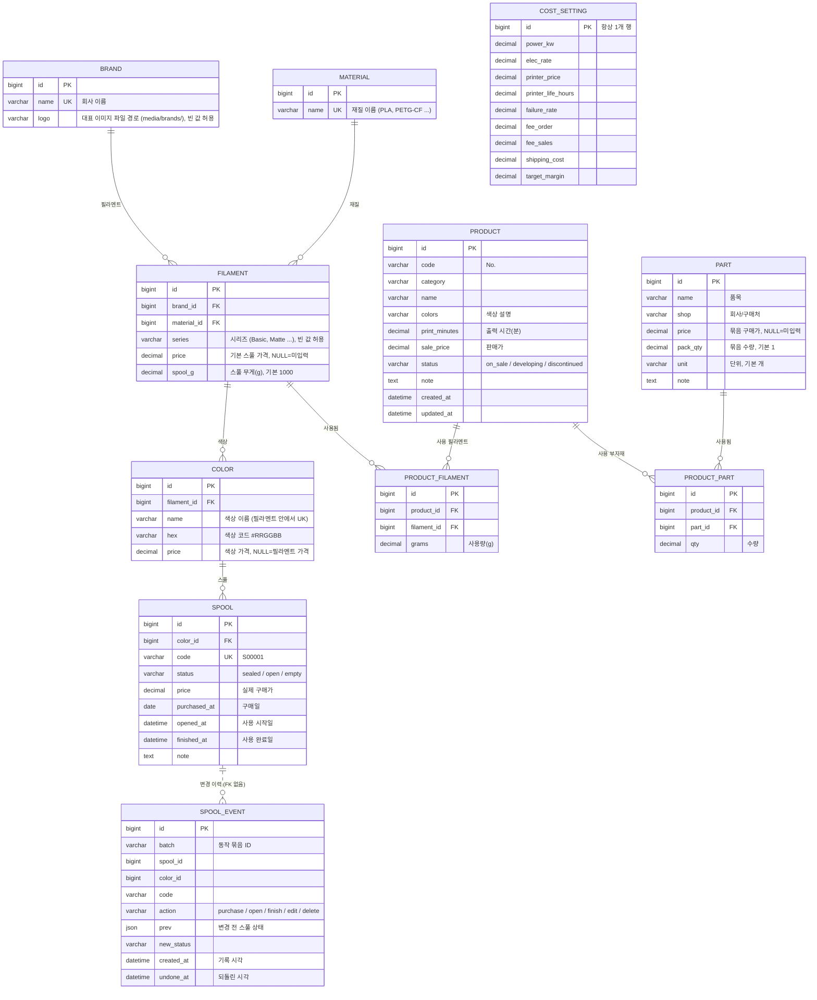

# ERD — Print Farm Farm (프린트팜팜)

> 요구사항: [PRD.md](PRD.md) · DB: SQLite (Django ORM)

## 다이어그램



## Django 앱 구성 (안)
| 앱 | 모델 |
|---|---|
| `filaments` | `Brand`, `Material`, `Filament`, `Color`, `Spool`, `SpoolEvent` |
| `products` | `Part`, `Product`, `ProductFilament`, `ProductPart`, `CostSetting` |

## 모델 설명

| 모델 | 설명 |
|---|---|
| `Brand` | 필라멘트 회사 (Bambu Lab, Esun …). 대표 이미지는 `ImageField` — 파일은 `media/brands/`, DB 에는 경로만 |
| `Material` | 재질 종류. 회사와 상관없는 공통 목록 (PLA, PETG, PETG-CF …) |
| `Filament` | 회사 + 재질 + 시리즈 단위의 필라멘트 제품. 기본 스풀 가격·무게 |
| `Color` | 필라멘트 안의 색상. 색상 코드(hex)를 가지며, 가격을 비우면 필라멘트 가격을 따름. 재고는 색상 단위로 셈 |
| `Spool` | 스풀 1개 = 1행. 상태, 날짜, 실제 구매가 |
| `SpoolEvent` | 스풀 변경 이력. 되돌리기에 사용 |
| `Part` | 부자재. `price ÷ pack_qty` 가 개당 단가 |
| `Product` | 판매 제품 |
| `ProductFilament` | 제품 ↔ 필라멘트 (다대다) + 사용량 |
| `ProductPart` | 제품 ↔ 부자재 (다대다) + 수량 |
| `CostSetting` | 원가 계산 설정값. 항상 1개 행만 존재 (기본값은 PRD 3.8) |

## 계산 규칙
```
필라멘트 표시 이름 = "{Brand.name} › {Material.name} {Filament.series}"   예: Bambu Lab › PLA Matte

색상의 스풀 가격 = Color.price 가 있으면 그 값, 없으면 Filament.price
g당 가격        = 색상의 스풀 가격 ÷ Filament.spool_g

회사별 무게 (PRD SUM-04)
  상태별 kg = 그 상태 스풀 수 × Filament.spool_g ÷ 1000   (필라멘트마다 계산해서 합산)
  (재고 / 사용 중 / 사용 완료 각각 표시, 비율 막대는 세 값의 비율)

보유 스풀 평균 구매가 (PRD INV-08) = 재고 + 사용 중 스풀의 Spool.price 평균
```

## 관계와 삭제 규칙
| 관계 | on_delete | 의미 |
|---|---|---|
| `Filament.brand` → `Brand` | PROTECT | 필라멘트가 있으면 회사 삭제 불가 |
| `Filament.material` → `Material` | PROTECT | 필라멘트가 있으면 재질 삭제 불가 |
| `Color.filament` → `Filament` | PROTECT | 색상이 있으면 필라멘트 삭제 불가 |
| `Spool.color` → `Color` | PROTECT | 스풀이 있으면 색상 삭제 불가 |
| `ProductFilament.filament` → `Filament` | PROTECT | 제품에서 쓰면 필라멘트 삭제 불가 |
| `ProductPart.part` → `Part` | PROTECT | 제품에서 쓰면 부자재 삭제 불가 |
| `ProductFilament.product` → `Product` | CASCADE | 제품 삭제 시 함께 삭제 |
| `ProductPart.product` → `Product` | CASCADE | 제품 삭제 시 함께 삭제 |
| `SpoolEvent.spool_id` | FK 없음 | 스풀이 삭제돼도 이력은 남아야 하고, 삭제 되돌리기 시 같은 id 로 복원하기 때문 |

## 제약 조건 · 인덱스
| 대상 | 종류 | 용도 |
|---|---|---|
| `Brand.name` | UNIQUE | 회사 이름 중복 방지 |
| `Material.name` | UNIQUE | 재질 이름 중복 방지 |
| `Filament (brand, material, series)` | UNIQUE | 같은 필라멘트 중복 방지 |
| `Color (filament, name)` | UNIQUE | 같은 필라멘트 안 색상 이름 중복 방지 |
| `Color.hex` | 형식 검사 | `#` + 16진수 6자리. 입력은 `F5F5F5` / `#f5f5f5` 모두 받아 `#F5F5F5` 로 저장 |
| `Spool.code` | UNIQUE | 스풀 코드 |
| `Spool.status` | CHOICES | `sealed`(재고) / `open`(사용 중) / `empty`(사용 완료) |
| `Spool (color, status)` | INDEX | 색상별 상태 개수 집계 |
| `SpoolEvent.batch` | INDEX | batch 단위 되돌리기 |
| `SpoolEvent.spool_id` | INDEX | "이 스풀에 이후 기록이 있는지" 검사 |

## 참고 사항
- 금액·무게·수량은 `DecimalField` (부동소수점 오차 방지). 원 단위 반올림은 화면/CSV 에서 한다.
- 날짜·시각은 `USE_TZ=True` 로 UTC 저장, 화면에는 서울 시간으로 표시.
- `SpoolEvent.prev` 에는 변경 전 `Spool` 의 모든 필드를 JSON 으로 저장한다 (삭제 복원용).
- `Spool.code` 는 저장 직후 `id` 로 만든다: `S` + id 5자리 (`S00001`).
- `Brand.logo` 는 업로드 시 256×256px 이내로 축소해 저장 (Pillow). 회사를 삭제하거나 이미지를 바꾸면 이전 파일도 지운다.
- `Filament.series` 는 빈 문자열 허용 (NULL 대신 `""`) — UNIQUE 조합에서 시리즈 없는 필라멘트도 중복 검사되도록.
