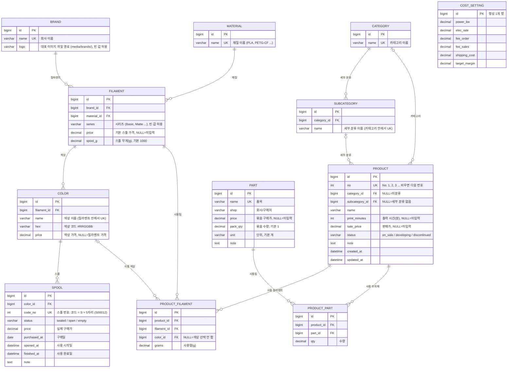

# ERD — 3D Farm Farm (쓰리디팜팜)

> 요구사항: [PRD.md](PRD.md) · DB: SQLite (Django ORM)

## 다이어그램



## Django 앱 구성 (안)
| 앱 | 모델 |
|---|---|
| `filaments` | `Brand`, `Material`, `Filament`, `Color`, `Spool` |
| `products` | `Category`, `Subcategory`, `Part`, `Product`, `ProductFilament`, `ProductPart`, `CostSetting` |

## 모델 설명

| 모델 | 설명 |
|---|---|
| `Brand` | 필라멘트 회사 (Bambu Lab, Esun …). 대표 이미지는 `ImageField` — 파일은 `media/brands/`, DB 에는 경로만 |
| `Material` | 재질 종류. 회사와 상관없는 공통 목록 (PLA, PETG, PETG-CF …) |
| `Filament` | 회사 + 재질 + 시리즈 단위의 필라멘트 제품. 기본 스풀 가격·무게 |
| `Color` | 필라멘트 안의 색상. 색상 코드(hex)를 가지며, 가격을 비우면 필라멘트 가격을 따름. 재고는 색상 단위로 셈 |
| `Spool` | 스풀 1개 = 1행. 스풀 번호, 상태, 날짜, 실제 구매가 |
| `Part` | 부자재. `price ÷ pack_qty` 가 개당 단가 |
| `Category` | 제품 카테고리 (수업 교구, 퍼즐 …) |
| `Subcategory` | 카테고리 안의 세부 분류 (수업 교구 › 수학 …). 선택 |
| `Product` | 판매 제품. 카테고리 · 세부 분류는 비워도 됨 (미분류) |
| `ProductFilament` | 제품 ↔ 필라멘트 (다대다) + 사용량 + 색상(선택). 같은 필라멘트를 색상별로 여러 줄 둘 수 있음 |
| `ProductPart` | 제품 ↔ 부자재 (다대다) + 수량 |
| `CostSetting` | 원가 계산 설정값. 항상 1개 행만 존재 (기본값은 PRD 3.8) |

## 계산 규칙
```
필라멘트 표시 이름 = "{Brand.name} › {Material.name} {Filament.series}"   예: Bambu Lab › PLA Matte

색상의 스풀 가격 = Color.price 가 있으면 그 값, 없으면 Filament.price
g당 가격        = 색상의 스풀 가격 ÷ Filament.spool_g

제품 필라멘트비 (PRD 3.6) = Σ ProductFilament.grams × g당 가격
  g당 가격은 ProductFilament.color 가 있으면 그 색상 기준, 없으면 Filament.price ÷ Filament.spool_g

회사별 무게 (PRD SUM-04)
  상태별 kg = 그 상태 스풀 수 × Filament.spool_g ÷ 1000   (필라멘트마다 계산해서 합산)
  (재고 / 사용 중 / 사용 완료 각각 표시, 비율 막대는 세 값의 비율)

보유 스풀 평균 구매가 (PRD INV-08) = 재고 + 사용 중 스풀의 Spool.price 평균
```

## 관계와 삭제 규칙
| 관계 | on_delete | 의미 |
|---|---|---|
| `Filament.brand` → `Brand` | PROTECT | 필라멘트가 있으면 회사 삭제 불가 |
| `Filament.material` → `Material` | PROTECT | 필라멘트가 있으면 재질 삭제 불가 |
| `Color.filament` → `Filament` | PROTECT | 색상이 있으면 필라멘트 삭제 불가 |
| `Spool.color` → `Color` | PROTECT | 스풀이 있으면 색상 삭제 불가 |
| `ProductFilament.filament` → `Filament` | PROTECT | 제품에서 쓰면 필라멘트 삭제 불가 |
| `ProductPart.part` → `Part` | PROTECT | 제품에서 쓰면 부자재 삭제 불가 |
| `ProductFilament.color` → `Color` | SET_NULL | 색상을 지우면 그 줄은 색상 선택 안 함 (필라멘트 가격으로 계산). 지우기 전에 쓰는 제품을 알려 주고 확인 ([TBD-04](TBD.md)) |
| `Product.category` → `Category` | PROTECT | 제품이 있으면 카테고리 삭제 불가 |
| `Product.subcategory` → `Subcategory` | PROTECT | 제품이 있으면 세부 분류 삭제 불가 |
| `Subcategory.category` → `Category` | CASCADE | 카테고리 삭제 시 (제품이 없을 때만 가능) 세부 분류도 함께 삭제 |
| `ProductFilament.product` → `Product` | CASCADE | 제품 삭제 시 함께 삭제 |
| `ProductPart.product` → `Product` | CASCADE | 제품 삭제 시 함께 삭제 |

## 제약 조건 · 인덱스
| 대상 | 종류 | 용도 |
|---|---|---|
| `Brand.name` | UNIQUE | 회사 이름 중복 방지 |
| `Material.name` | UNIQUE | 재질 이름 중복 방지 |
| `Filament (brand, material, series)` | UNIQUE | 같은 필라멘트 중복 방지 |
| `Color (filament, name)` | UNIQUE | 같은 필라멘트 안 색상 이름 중복 방지 |
| `Color.hex` | 형식 검사 | `#` + 16진수 6자리. 입력은 `F5F5F5` / `#f5f5f5` 모두 받아 `#F5F5F5` 로 저장 |
| `Spool.code_no` | UNIQUE | 스풀 번호 (= 스풀 코드) 중복 방지 |
| `Spool.status` | CHOICES | `sealed`(재고) / `open`(사용 중) / `empty`(사용 완료) |
| `Spool (color, status)` | INDEX | 색상별 상태 개수 집계 |
| `Part.name` | UNIQUE | 부자재 품목 이름 중복 방지 |
| `Category.name` | UNIQUE | 카테고리 이름 중복 방지 |
| `Subcategory (category, name)` | UNIQUE | 같은 카테고리 안 세부 분류 이름 중복 방지 |
| `Product.no` | UNIQUE | 제품 No. 중복 방지 |
| `Product.subcategory` | 검사 | 세부 분류는 그 제품의 카테고리에 속해야 함 (`Product.clean`) |
| `ProductFilament.color` | 검사 | 색상은 그 줄의 필라멘트에 속해야 함 (`ProductFilament.clean`) |

## 참고 사항
- 금액·무게·수량은 `DecimalField` (부동소수점 오차 방지). 원 단위 반올림은 화면/CSV 에서 한다.
- 날짜·시각은 `USE_TZ=True` 로 UTC 저장, 화면에는 서울 시간으로 표시.
- 스풀 삭제는 행을 지운다. 변경 이력은 남기지 않는다 (PRD 3.5). 실수로 지웠으면 같은 번호로 다시 등록한다.
- 스풀 코드는 사용자 · 라벨용 식별자라서 DB `id` 와 따로 `code_no`(번호)로 저장한다. id 는 DB 를 옮기거나 다시 만들면
  바뀔 수 있지만, 라벨에 찍힌 코드는 바뀌면 안 되기 때문.
  - 표시: `S` + 번호 최소 5자리 (`12` → `S00012`, `123456` → `S123456`). 코드로 찾을 때는 번호로 바꿔서 찾는다
    (`Spool.code_no_from_code`).
  - 번호: 비우면 자동으로 지금 있는 가장 큰 번호 + 1 (`Spool.next_code_no`), 원하면 직접 지정. 1 이상, 중복 불가.
    스풀을 지우면 그 번호는 비므로 같은 번호로 다시 등록할 수 있다.
  - 글자(`S00012`)가 아니라 숫자로 저장하는 이유: 가장 큰 번호를 구할 때 `S100000` < `S99999` 같은 글자 정렬 문제를 피하려고.
- `Brand.logo` 는 png · jpg · webp, 5MB 까지. 업로드 시 비율을 유지해 256×256px 이내로 축소해 저장 (Pillow, `Brand.save`).
  회사를 삭제하거나 이미지를 바꾸거나 지우면 이전 파일도 지운다 (DB 저장이 확정된 뒤에).
- `Filament.series` 는 빈 문자열 허용 (NULL 대신 `""`) — UNIQUE 조합에서 시리즈 없는 필라멘트도 중복 검사되도록.
- `Product.no`(No.)는 숫자로 저장하고 화면에도 `1, 2, 3 …` 그대로 보여 준다 (글자로 저장하면 자릿수가 다를 때 `10` 이 `2` 보다 앞에 정렬되므로).
  비우면 지금 있는 가장 큰 번호 + 1 (`Product.next_no`), 원하면 직접 지정. 1 이상, 중복 불가.
- `CostSetting` 의 % 값(수수료 · 목표 마진율)은 퍼센트 숫자 그대로 저장한다 (`1.98` = 1.98%). 0 ~ 100.
  `CostSetting.load()` 로 읽고, 행이 없으면 기본값(PRD 3.8)으로 만든다.
