# ERD — 3D Farm Farm (쓰리디팜팜)

> 요구사항: [PRD.md](PRD.md) · DB: SQLite (Django ORM)

## 다이어그램

```mermaid
erDiagram
    BRAND ||--o{ FILAMENT : "필라멘트"
    MATERIAL ||--o{ FILAMENT : "재질"
    FILAMENT ||--o{ COLOR : "색상"
    COLOR ||--o{ SPOOL : "스풀"
    CATEGORY ||--o{ SUBCATEGORY : "세부 분류"
    CATEGORY |o--o{ PRODUCT : "카테고리"
    SUBCATEGORY |o--o{ PRODUCT : "세부 분류"
    PRODUCT ||--o{ PRODUCT_FILAMENT : "사용 필라멘트"
    FILAMENT ||--o{ PRODUCT_FILAMENT : "사용됨"
    COLOR |o--o{ PRODUCT_FILAMENT : "사용 색상"
    PRODUCT ||--o{ PRODUCT_PART : "사용 부속품"
    PART ||--o{ PRODUCT_PART : "사용됨"
    PART_CATEGORY |o--o{ PART : "카테고리"
    PART ||--o{ STOCK_HISTORY : "입출고 기록"
    PACK_SET ||--o{ PACK_SET_LINE : "들어가는 포장재"
    PART ||--o{ PACK_SET_LINE : "사용됨"
    PACK_SET |o--o{ PRODUCT : "기본 포장"
    RECURRING_EXPENSE |o--o{ EXPENSE : "넣은 지출"
    SALE ||--o{ SALE_ITEM : "판매 제품"
    PRODUCT |o--o{ SALE_ITEM : "팔린 제품"
    SALE ||--o{ SALE_PACK : "포장 줄"
    PART |o--o{ SALE_PACK : "쓴 포장재"
    SALE |o--o{ STOCK_HISTORY : "판매로 빠진 수량"
    EXPENSE ||--o{ EXPENSE_ITEM : "구매 항목"
    COLOR |o--o{ EXPENSE_ITEM : "산 색상"
    PART |o--o{ EXPENSE_ITEM : "산 품목"
    EXPENSE_ITEM |o--o{ SPOOL : "지출 저장으로 생긴 스풀"
    EXPENSE |o--o{ STOCK_HISTORY : "구매로 늘어난 수량"

    BRAND {
        bigint id PK
        varchar name UK "회사 이름"
        varchar logo "대표 이미지 파일 경로 (media/brands/), 빈 값 허용"
    }
    MATERIAL {
        bigint id PK
        varchar name UK "재질 이름 (PLA, PETG-CF ...)"
    }
    FILAMENT {
        bigint id PK
        bigint brand_id FK
        bigint material_id FK
        varchar series "시리즈 (Basic, Matte ...), 빈 값 허용"
        decimal price "기본 스풀 가격, NULL=미입력"
        decimal spool_g "스풀 무게(g), 기본 1000"
    }
    COLOR {
        bigint id PK
        bigint filament_id FK
        varchar name "색상 이름 (필라멘트 안에서 UK)"
        varchar hex "색상 코드 #RRGGBB"
        decimal price "색상 가격, NULL=필라멘트 가격"
    }
    SPOOL {
        bigint id PK
        bigint color_id FK
        int code_no UK "스풀 번호. 코드 = S + 5자리 (S00012)"
        varchar status "sealed / open / empty"
        decimal price "실제 구매가"
        date purchased_at "구매일"
        datetime opened_at "사용 시작일"
        datetime finished_at "사용 완료일"
        text note
        bigint buy_id FK "주문(지출 구매 항목), NULL=재고 추가(지출 없이)"
    }
    PART_CATEGORY {
        bigint id PK
        varchar kind "part / pack / supply (탭)"
        varchar name "카테고리 이름 (탭 안에서 UK)"
    }
    PART {
        bigint id PK
        varchar kind "part(부속품) / pack(포장재) / supply(소모품)"
        varchar name UK "품목"
        bigint category_id FK "NULL=미분류, 같은 kind 만"
        varchar photo "사진 파일 경로 (media/parts/), 빈 값 허용"
        varchar shop "회사/구매처"
        varchar buy_url "구매 링크, 빈 문자열=없음"
        decimal price "묶음 구매가, NULL=미입력"
        decimal pack_qty "묶음 수량, 기본 1"
        varchar unit "단위, 기본 개"
        decimal stock "남은 수량 (0 아래 가능)"
        decimal alert "부족 알림 기준, 기본 0"
        text note
    }
    STOCK_HISTORY {
        bigint id PK
        bigint part_id FK
        date date
        varchar kind "buy / sale / use / adjust"
        decimal qty "늘면 +, 줄면 −"
        decimal after "그 뒤 남은 수량"
        varchar note "설명 (조정 사유 · 판매 요약)"
        bigint sale_id FK "판매로 빠진 기록, NULL=그 밖"
        bigint expense_id FK "지출 구매로 늘어난 기록, NULL=그 밖"
        datetime created_at
    }
    PACK_SET {
        bigint id PK
        varchar name UK "세트 이름"
        text note
    }
    PACK_SET_LINE {
        bigint id PK
        bigint pack_set_id FK
        bigint part_id FK "포장재"
        decimal qty "수량"
    }
    CATEGORY {
        bigint id PK
        varchar name UK "카테고리 이름"
    }
    SUBCATEGORY {
        bigint id PK
        bigint category_id FK
        varchar name "세부 분류 이름 (카테고리 안에서 UK)"
    }
    PRODUCT {
        bigint id PK
        int no UK "No. 1, 2, 3 ... 비우면 다음 번호"
        bigint category_id FK "NULL=미분류"
        bigint subcategory_id FK "NULL=세부 분류 없음"
        varchar name
        int print_minutes "출력 시간(분), NULL=미입력"
        decimal sale_price "판매가, NULL=미입력"
        bigint default_pack_id FK "기본 포장 세트, NULL=입력 필요"
        varchar status "on_sale / developing / discontinued"
        text note
        datetime created_at
        datetime updated_at
    }
    PRODUCT_FILAMENT {
        bigint id PK
        bigint product_id FK
        bigint filament_id FK
        bigint color_id FK "NULL=색상 선택 안 함"
        decimal grams "사용량(g) 소수 2자리"
    }
    PRODUCT_PART {
        bigint id PK
        bigint product_id FK
        bigint part_id FK
        decimal qty "수량"
    }
    EXPENSE {
        bigint id PK
        date date "지출 날짜 (오늘 이후 불가)"
        varchar name "항목"
        varchar category "invest / filament / part / pack / supply / sub / sell / etc"
        decimal amount "금액 (1원 이상, 배송비 포함)"
        varchar shop "구매처, 빈 값 허용"
        text note
        bigint recurring_id FK "반복 지출에서 넣은 줄, NULL=직접 입력"
        datetime created_at
    }
    EXPENSE_ITEM {
        bigint id PK
        bigint expense_id FK
        bigint color_id FK "필라멘트 지출: 색상 (part 와 둘 중 하나)"
        bigint part_id FK "부속품 · 포장재 · 소모품 지출: 그 탭의 품목"
        decimal qty "수량 (필라멘트는 롤 수, 정수)"
        decimal amount "직접 적은 금액, NULL=총액에서 나눠 넣음"
        decimal total "항목 금액 (적은 금액 또는 나눈 금액, 저장 때 계산)"
    }
    SPOOL_NUMBER {
        bigint id PK "항상 1"
        int last "지금까지 쓴 가장 큰 스풀 번호 (지운 번호를 다시 쓰지 않게)"
    }
    RECURRING_EXPENSE {
        bigint id PK
        varchar name
        varchar category "EXPENSE.category 와 같은 8개"
        decimal amount "금액 (1원 이상)"
        smallint day "결제일 1~31"
        date start "시작 달 (항상 1일)"
        text note
    }
    SALE {
        bigint id PK
        date date "판매 날짜"
        varchar channel "store / direct / etc"
        varchar order_no "주문번호, 빈 값 허용 (비어 있지 않으면 UNIQUE)"
        decimal shipping_received "손님이 낸 배송비"
        decimal fee "수수료"
        decimal shipping_cost "판매자가 낸 택배비 (주문별 이익 참고용)"
        text note
        datetime created_at
    }
    SALE_ITEM {
        bigint id PK
        bigint sale_id FK
        bigint product_id FK "NULL=제품을 지움"
        varchar product_name "팔 때의 제품명"
        int qty "수량 (1 이상)"
        decimal unit_price "단가"
        decimal unit_cost "팔 때 복사한 개당 원가 (포장 빼고), NULL=원가 없음"
    }
    SALE_PACK {
        bigint id PK
        bigint sale_id FK
        bigint part_id FK "NULL=포장재를 지움"
        varchar part_name "팔 때의 포장재 이름"
        decimal qty "수량"
        decimal unit_price "팔 때 복사한 개당 단가, NULL=구매가 없음"
    }
    COST_SETTING {
        bigint id PK "항상 1개 행"
        decimal power_kw
        decimal elec_rate
        decimal fee_order
        decimal fee_sales
        decimal shipping_cost
        decimal target_margin
    }
```



## Django 앱 구성 (안)
| 앱 | 모델 |
|---|---|
| `filaments` | `Brand`, `Material`, `Filament`, `Color`, `Spool` |
| `stock` | `PartCategory`, `Part`, `StockHistory`, `PackSet`, `PackSetLine` |
| `products` | `Category`, `Subcategory`, `Product`, `ProductFilament`, `ProductPart`, `CostSetting` |
| `expenses` | `Expense`, `ExpenseItem`, `RecurringExpense` |
| `sales` | `Sale`, `SaleItem`, `SalePack` |

## 모델 설명

| 모델 | 설명 |
|---|---|
| `Brand` | 필라멘트 회사 (Bambu Lab, Esun …). 대표 이미지는 `ImageField` — 파일은 `media/brands/`, DB 에는 경로만 |
| `Material` | 재질 종류. 회사와 상관없는 공통 목록 (PLA, PETG, PETG-CF …) |
| `Filament` | 회사 + 재질 + 시리즈 단위의 필라멘트 제품. 기본 스풀 가격·무게 |
| `Color` | 필라멘트 안의 색상. 색상 코드(hex)를 가지며, 가격을 비우면 필라멘트 가격을 따름. 재고는 색상 단위로 셈 |
| `Spool` | 스풀 1개 = 1행. 스풀 번호, 상태, 날짜, 실제 구매가, 주문(지출 구매 항목 — 필라멘트 지출을 저장하면 생긴 스풀) |
| `SpoolNumber` | 지금까지 쓴 가장 큰 스풀 번호 1행 (TBD-33). 새 번호는 `Spool.take_code_nos()` 로만 받아서 지운 번호를 다시 쓰지 않는다 |
| `PartCategory` | 품목 카테고리. 탭(`kind`)마다 따로 (부속품: 부품 · 키링 / 포장재: 박스 · 봉투 / 소모품: 접착 · 마감 …) |
| `Part` | 재고 품목 (v2 STOCK). `kind` 로 재고 관리 탭을 나눈다 — 부속품(제품 1개당 수량 → 원가) · 포장재(포장 세트 → 포장비) · 소모품(원가에 안 넣음). `price ÷ pack_qty` 가 개당 단가. 남은 수량 · 부족 알림 기준 · 사진 |
| `StockHistory` | 입출고 기록 한 줄 (STOCK-05). 지출 구매 · 판매 · 다 씀 · 조정. 남은 수량을 바꿀 때 항상 함께 만든다 (`stock/services.py`) |
| `PackSet` | 포장 세트 (봉투 포장 · 작은 박스 …, STOCK-06). 제품의 기본 포장 · 판매 주문의 포장 줄을 채운다 |
| `PackSetLine` | 포장 세트에 들어가는 포장재 + 수량 |
| `Category` | 제품 카테고리 (수업 교구, 퍼즐 …) |
| `Subcategory` | 카테고리 안의 세부 분류 (수업 교구 › 수학 …). 선택 |
| `Product` | 판매 제품. 카테고리 · 세부 분류는 비워도 됨 (미분류) |
| `ProductFilament` | 제품 ↔ 필라멘트 (다대다) + 사용량 + 색상(선택). 같은 필라멘트를 색상별로 여러 줄 둘 수 있음 |
| `ProductPart` | 제품 ↔ 부속품 (다대다) + 수량. 포장재는 `Product.default_pack` 으로 따로 |
| `CostSetting` | 원가 계산 설정값. 항상 1개 행만 존재 (기본값은 PRD 3.8) |
| `Expense` | 지출 한 줄 = 주문 하나 (PRD 3.10). 분류는 고정 8개 (`ExpenseCategory`) |
| `ExpenseItem` | 지출의 구매 항목 (PRD EXP-08, v2 TBD-31 · 33). 필라멘트 지출은 색상 · 롤 수, 부속품 · 포장재 · 소모품 지출은 그 탭의 품목 · 수량 + 금액(비우면 나눠 넣음). 같은 색상 · 품목 여러 항목 가능 |
| `RecurringExpense` | 반복 지출 (구독 · 월정액). 지출을 저절로 만들지 않고, 화면에서 확인하고 넣는다 |
| `Sale` | 판매 한 건 = 주문 하나 (v2 SALE). 판매처는 고정 3개 (`SaleChannel`). 배송비 · 수수료는 주문 단위 |
| `SaleItem` | 판매 안의 제품 한 줄. 단가 · 수량 · 팔 때 복사한 개당 원가(포장 빼고) · 제품명 |
| `SalePack` | 판매 주문의 포장 줄 (SALE-06). 포장재 · 수량 · 팔 때 복사한 단가 · 이름. 제품 줄과 따로 주문 단위 (묶음 포장) |

## 계산 규칙
```
필라멘트 표시 이름 = "{Brand.name} › {Material.name} {Filament.series}"   예: Bambu Lab › PLA Matte

색상의 스풀 가격 = Color.price 가 있으면 그 값, 없으면 Filament.price
g당 가격        = 색상의 스풀 가격 ÷ Filament.spool_g

제품 필라멘트비 (PRD 3.6) = Σ ProductFilament.grams × g당 가격
  g당 가격은 ProductFilament.color 가 있으면 그 색상 기준, 없으면 Filament.price ÷ Filament.spool_g

회사별 무게 (PRD SUM-04)
  상태별 kg = 그 상태 스풀 수 × Filament.spool_g ÷ 1000   (필라멘트마다 계산해서 합산)
  (재고 / 사용 중 / 사용 완료 각각 표시, 비율 막대는 세 값의 비율)

보유 스풀 평균 구매가 (PRD INV-08) = 재고 + 사용 중 스풀의 Spool.price 평균

반복 지출 결제일 (PRD EXP-04) = 그 달의 RecurringExpense.day, 그 달 말일보다 크면 말일 (RecurringExpense.pay_date)
이번 달에 넣을 반복 지출 = 시작 달 ≤ 이번 달 이고, 이번 달 결제일 ≤ 오늘 이고, 이번 달에 그 반복에서 넣은 지출이 없는 것
누적 투자금 (PRD EXP-05) = category 가 invest 인 Expense.amount 합계 (전체 기간)

구매 항목 금액 (PRD EXP-08, expenses.models.split_totals)
  ExpenseItem.total = amount 가 있으면 그 값,
                      없으면 (Expense.amount − 금액 적은 항목 합계) × 무게 ÷ 비운 항목 무게 합 (무게: 필라멘트는 qty, 그 밖은 1)
  1개(롤)당 금액 = total ÷ qty
최근 구매 = 그 색상 · 품목이 들어 있는 Expense 중 date → id 가 가장 큰 것 (expenses.models.latest_buy)
최근 구매가 (원가 계산표 단가) — 구매 항목이 바뀔 때 최근 구매로 다시 맞춤 (refresh_buy_prices). 그 지출의 같은 것 항목은 합침
  Color.price = Σ total ÷ Σ qty (원 단위 반올림)
  Part.price · Part.pack_qty = Σ total(원 단위) · Σ qty
필라멘트 항목 → 스풀 (filaments.services.sync_item, 지출 → 스풀 한 방향, 차이만)
  스풀 수 변화 = 새 qty − 저장 전 qty (새 항목은 qty). + 면 새 스풀(재고), − 면 그 항목의 재고 스풀을 code_no 큰 것부터 지움
  그 항목 스풀 전부: color = 항목 색상, price = 롤당 금액(원 단위 반올림), purchased_at = Expense.date
  줄일 수 있는 최소 롤 수 = 저장 전 qty − 그 항목의 재고 스풀 수
다음 스풀 번호 = max(SpoolNumber.last, 지금 있는 가장 큰 code_no) + 1 (Spool.next_code_no) — 지운 번호는 다시 안 씀

판매가 합계 (v2 SALE-01) = Σ SaleItem.unit_price × qty
스마트스토어 수수료 (SALE-03) = (판매가 합계 + Sale.shipping_received) × (CostSetting.fee_order + fee_sales)%, 원 단위 반올림 (Sale.store_fee)
  직접 판매 · 기타는 0 (있으면 직접 입력). 고친 수수료는 그대로 저장
정산 금액 = 판매가 합계 + shipping_received − fee
주문별 이익 (SALE-05, 참고) = 정산 금액 − Σ SaleItem.unit_cost × qty − 포장비 − shipping_cost. unit_cost 가 NULL 인 줄이 있으면 이익 없음
  포장비 (SALE-06) = Σ SalePack.unit_price × qty

포장 세트 원가 (STOCK-06) = Σ PackSetLine.qty × 포장재 개당 단가 → 제품 원가의 포장비 (Product.default_pack)
바로 쌀 수 있는 수 = 세트 줄마다 ⌊max(0, Part.stock) ÷ qty⌋ 중 가장 작은 값
남은 수량 상태 (STOCK-04) = stock ≤ 0 이면 없음, stock ≤ alert 이면 부족
판매로 빠지는 수량 = Σ 제품 줄의 (ProductPart.qty × SaleItem.qty) + Σ SalePack.qty  (품목별)
  판매를 저장할 때마다 이미 그 판매로 기록된 수량과 비교해 차이만 기록 (`services.sync_sale`), 지우기 전에 되돌리는 기록 (`services.revert_sale`)
```

## 관계와 삭제 규칙
| 관계 | on_delete | 의미 |
|---|---|---|
| `Filament.brand` → `Brand` | PROTECT | 필라멘트가 있으면 회사 삭제 불가 |
| `Filament.material` → `Material` | PROTECT | 필라멘트가 있으면 재질 삭제 불가 |
| `Color.filament` → `Filament` | PROTECT | 색상이 있으면 필라멘트 삭제 불가 |
| `Spool.color` → `Color` | CASCADE | 색상을 지우면 그 색상의 스풀도 함께 삭제. 지우기 전에 스풀 개수를 알려 주고 2차 확인 |
| `ProductFilament.filament` → `Filament` | PROTECT | 제품에서 쓰면 필라멘트 삭제 불가 |
| `ProductPart.part` → `Part` | PROTECT | 제품에서 쓰면 부속품 삭제 불가 |
| `Part.category` → `PartCategory` | SET_NULL | 카테고리를 지우면 그 품목은 미분류 (원가는 그대로). 품목이 있으면 화면에서 2차 확인 |
| `StockHistory.part` → `Part` | CASCADE | 품목을 지우면 그 입출고 기록도 함께 삭제 |
| `StockHistory.sale` → `Sale` | SET_NULL | 판매를 지우면 되돌리는 기록을 남긴 뒤 연결만 끊김 |
| `StockHistory.expense` → `Expense` | SET_NULL | 지출을 지우면 되돌리는 기록(`지출 삭제`)을 남긴 뒤 연결만 끊김 |
| `ExpenseItem.expense` → `Expense` | CASCADE | 지출을 지우면 구매 항목도 함께 삭제 (그 전에 재고 스풀을 지우고 남은 수량을 되돌림. 사용한 스풀이 있으면 지출 삭제 409) |
| `ExpenseItem.color` → `Color` · `ExpenseItem.part` → `Part` | CASCADE | 색상 · 품목을 지우면 그 구매 항목도 함께 삭제 (지출 금액은 그대로) |
| `Spool.buy` → `ExpenseItem` | SET_NULL | 보통은 항목을 지우기 전에 그 재고 스풀을 지운다 (filaments.services.drop). 관리자 화면 등에서 바로 지우면 스풀은 남고 연결만 끊김 |
| `PackSetLine.pack_set` → `PackSet` | CASCADE | 세트를 지우면 구성도 함께 삭제 |
| `PackSetLine.part` → `Part` | PROTECT | 세트에서 쓰면 포장재 삭제 불가 |
| `Product.default_pack` → `PackSet` | PROTECT | 기본 포장으로 쓰는 제품이 있으면 세트 삭제 불가 |
| `ProductFilament.color` → `Color` | SET_NULL | 색상을 지우면 그 줄은 색상 선택 안 함 (필라멘트 가격으로 계산). 지우기 전에 쓰는 제품을 알려 주고 확인 (PRD FIL-09) |
| `Product.category` → `Category` | PROTECT | 제품이 있으면 카테고리 삭제 불가 |
| `Product.subcategory` → `Subcategory` | PROTECT | 제품이 있으면 세부 분류 삭제 불가 |
| `Subcategory.category` → `Category` | CASCADE | 카테고리 삭제 시 (제품이 없을 때만 가능) 세부 분류도 함께 삭제 |
| `ProductFilament.product` → `Product` | CASCADE | 제품 삭제 시 함께 삭제 |
| `ProductPart.product` → `Product` | CASCADE | 제품 삭제 시 함께 삭제 |
| `Expense.recurring` → `RecurringExpense` | SET_NULL | 반복 지출을 지워도 이미 넣은 지출은 남는다 (연결만 끊김) |
| `SaleItem.sale` → `Sale` | CASCADE | 판매를 지우면 그 제품 줄도 함께 삭제 |
| `SaleItem.product` → `Product` | SET_NULL | 제품을 지워도 판매 줄은 남고, 팔 때 저장한 `product_name` 으로 보인다 |
| `SalePack.sale` → `Sale` | CASCADE | 판매를 지우면 포장 줄도 함께 삭제 |
| `SalePack.part` → `Part` | SET_NULL | 포장재를 지워도 포장 줄은 남고, 팔 때 저장한 `part_name` · 단가로 보인다 |

## 제약 조건 · 인덱스
| 대상 | 종류 | 용도 |
|---|---|---|
| `Brand.name` | UNIQUE | 회사 이름 중복 방지 |
| `Material.name` | UNIQUE | 재질 이름 중복 방지 |
| `Filament (brand, material, series)` | UNIQUE | 같은 필라멘트 중복 방지 |
| `Color (filament, name)` | UNIQUE | 같은 필라멘트 안 색상 이름 중복 방지 |
| `Color.hex` | 형식 검사 | `#` + 16진수 6자리. 입력은 `F5F5F5` / `#f5f5f5` 모두 받아 `#F5F5F5` 로 저장 |
| `Spool.code_no` | UNIQUE | 스풀 번호 (= 스풀 코드) 중복 방지 |
| `Spool.status` | CHOICES | `sealed`(재고) / `open`(사용 중) / `empty`(사용 완료) |
| `Spool (color, status)` | INDEX | 색상별 상태 개수 집계 |
| `Part.name` | UNIQUE | 품목 이름 중복 방지 (탭이 달라도) |
| `PartCategory (kind, name)` | UNIQUE | 같은 탭 안 카테고리 이름 중복 방지 |
| `Part.category` | 검사 | 카테고리는 같은 탭(kind)의 것 (`Part.clean`) |
| `Part.kind` · `PartCategory.kind` | CHOICES | `part`(부속품) / `pack`(포장재) / `supply`(소모품) |
| `StockHistory.kind` | CHOICES | `buy`(지출) / `sale`(판매) / `use`(다 씀) / `adjust`(조정) |
| `PackSet.name` | UNIQUE | 포장 세트 이름 중복 방지 |
| `Category.name` | UNIQUE | 카테고리 이름 중복 방지 |
| `Subcategory (category, name)` | UNIQUE | 같은 카테고리 안 세부 분류 이름 중복 방지 |
| `Product.no` | UNIQUE | 제품 No. 중복 방지 |
| `Product.subcategory` | 검사 | 세부 분류는 그 제품의 카테고리에 속해야 함 (`Product.clean`) |
| `ProductFilament.color` | 검사 | 색상은 그 줄의 필라멘트에 속해야 함 (`ProductFilament.clean`) |
| `Expense.category` · `RecurringExpense.category` | CHOICES | 고정 8개 (PRD EXP-03). 키는 v1.2.0 그대로 (`invest` = 장비, `part` = 부속품 — 기존 `부자재` 지출) + `pack`(포장재) |
| `ExpenseItem (color, part)` | CHECK | 둘 중 하나만 (`expense_item_color_or_part`) |
| `ExpenseItem` | 검사 | 분류가 필라멘트면 색상 · 정수 롤 수, 부속품 · 포장재 · 소모품이면 같은 탭의 품목. 필라멘트가 아니면 금액 비운 항목은 하나까지. 금액 적은 항목 합계 ≤ 지출 금액. 사용한 스풀이 있는 항목은 색상 변경 · 빼기 불가, 롤 수는 재고 스풀만큼만 줄이기 (`ExpenseSerializer._check_items`) |
| `Spool.price` | 검사 | `buy` 가 있는 스풀(지출로 생김)은 구매가를 못 고침 (`SpoolSerializer.validate_price`) |
| `Expense (recurring, 연 · 월)` | 검사 | 같은 반복 지출은 한 달에 한 줄만 (`ExpenseSerializer.validate`) |
| `Sale.channel` | CHOICES | `store`(스마트스토어) / `direct`(직접 판매) / `etc`(기타) |
| `Sale.order_no` | UNIQUE (빈 값 제외) | 같은 주문을 두 번 넣지 않게 (스마트스토어 가져오기). 빈 주문번호는 여러 개 가능 |
| `SaleItem.qty` | 검사 | 1 이상 |

## 참고 사항
- 금액·무게·수량은 `DecimalField` (부동소수점 오차 방지). 원 단위 반올림은 화면/CSV 에서 한다.
- 날짜·시각은 `USE_TZ=True` 로 UTC 저장, 화면에는 서울 시간으로 표시.
- 스풀 삭제는 행을 지운다. 변경 이력은 남기지 않는다 (PRD 3.5). 실수로 지웠으면 같은 번호로 다시 등록한다.
- 스풀 코드는 사용자 · 라벨용 식별자라서 DB `id` 와 따로 `code_no`(번호)로 저장한다. id 는 DB 를 옮기거나 다시 만들면
  바뀔 수 있지만, 라벨에 찍힌 코드는 바뀌면 안 되기 때문.
  - 표시: `S` + 번호 최소 5자리 (`12` → `S00012`, `123456` → `S123456`). 코드로 찾을 때는 번호로 바꿔서 찾는다
    (`Spool.code_no_from_code`).
  - 번호: 비우면 자동으로 지금까지 쓴 가장 큰 번호 + 1 (`Spool.take_code_nos`, `SpoolNumber`). 1 이상, 중복 불가.
    지운 번호는 다시 쓰지 않는다 (라벨을 붙였다가 지운 스풀의 번호가 다른 스풀에 붙지 않게, TBD-33).
    직접 지정은 되돌리기(지운 스풀을 같은 번호로 다시 만들기)용.
  - 글자(`S00012`)가 아니라 숫자로 저장하는 이유: 가장 큰 번호를 구할 때 `S100000` < `S99999` 같은 글자 정렬 문제를 피하려고.
- `Brand.logo` 는 png · jpg · webp, 5MB 까지. 업로드 시 비율을 유지해 256×256px 이내로 축소해 저장 (Pillow, `ShrinkImageMixin`).
  회사를 삭제하거나 이미지를 바꾸거나 지우면 이전 파일도 지운다 (DB 저장이 확정된 뒤에). `Part.photo` 도 같은 방식, 512×512px 이내.
- `Part.stock` 은 `StockHistory.qty` 를 다 더한 값과 같게 유지한다 — 남은 수량은 `services.move()` 로만 바꾸고(기록과 함께), API 로 직접 고치지 않는다.
  0 아래로 내려가도 막지 않는다 (판매를 먼저 넣고 구매를 나중에 넣을 때 — 화면에서 경고만).
- 부자재(`Part` · `PartCategory`)는 v2 에서 `products` → `stock` 앱으로 옮겼다. 데이터는 그대로 두고 소속만 옮긴 뒤
  테이블 이름을 `stock_*` 로 바꾼다 (`stock 0001` → `products 0006` → `stock 0002`, SeparateDatabaseAndState).
- v2 STOCK 마이그레이션(`products 0007`)이 기존 데이터를 옮긴다: `포장재` 카테고리와 그 품목 → 포장재(kind=pack),
  제품의 포장재 줄 → 기본 포장 세트 `{제품명} 포장` (구성이 같은 제품은 세트 하나). 그 밖의 품목은 부속품 그대로.
- `Filament.series` 는 빈 문자열 허용 (NULL 대신 `""`) — UNIQUE 조합에서 시리즈 없는 필라멘트도 중복 검사되도록.
- `Product.no`(No.)는 숫자로 저장하고 화면에도 `1, 2, 3 …` 그대로 보여 준다 (글자로 저장하면 자릿수가 다를 때 `10` 이 `2` 보다 앞에 정렬되므로).
  비우면 지금 있는 가장 큰 번호 + 1 (`Product.next_no`), 원하면 직접 지정. 1 이상, 중복 불가.
- `CostSetting` 의 % 값(수수료 · 목표 마진율)은 퍼센트 숫자 그대로 저장한다 (`1.98` = 1.98%). 0 ~ 100.
  `CostSetting.load()` 로 읽고, 행이 없으면 기본값(PRD 3.8)으로 만든다.
