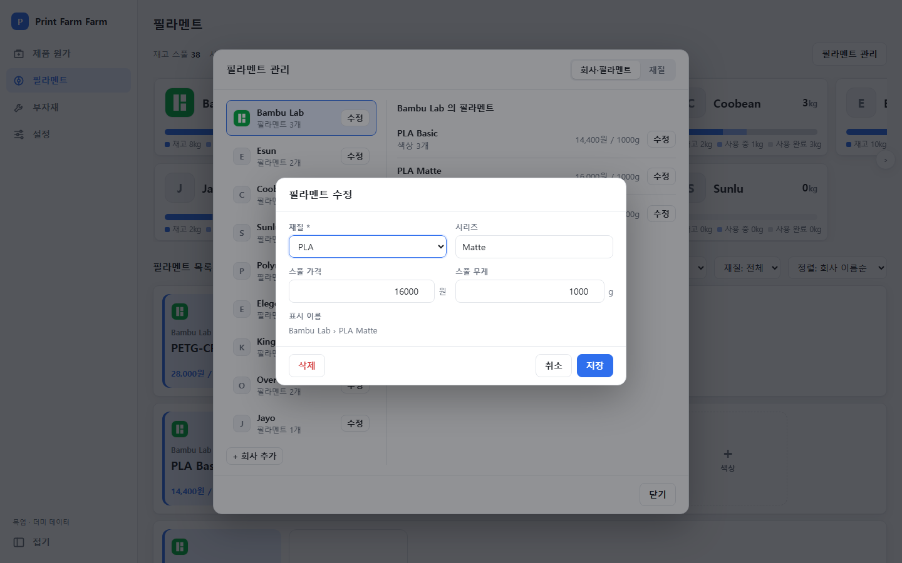
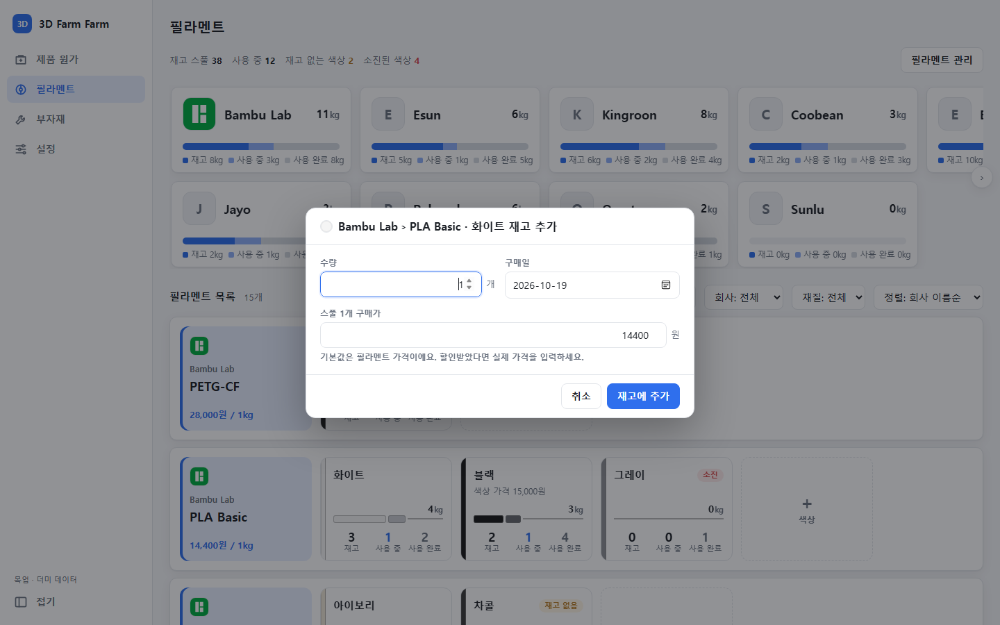
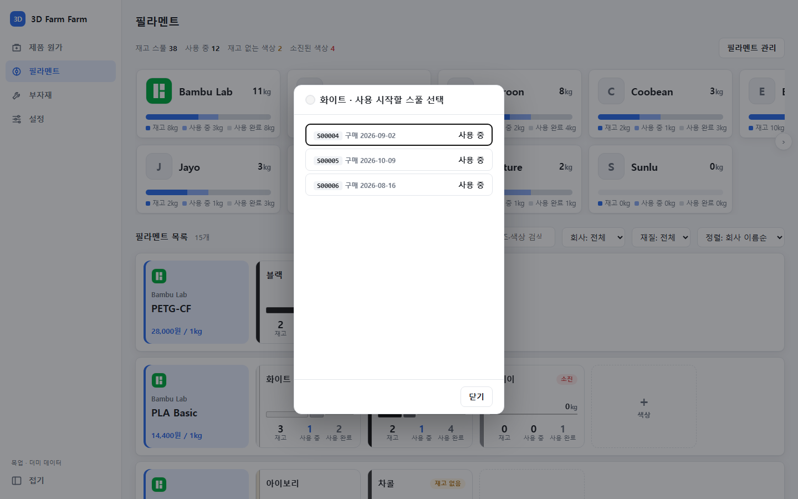
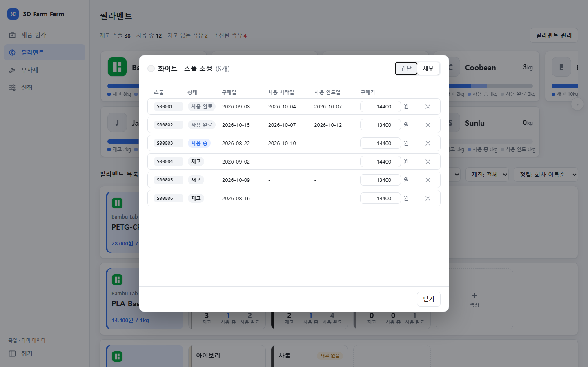
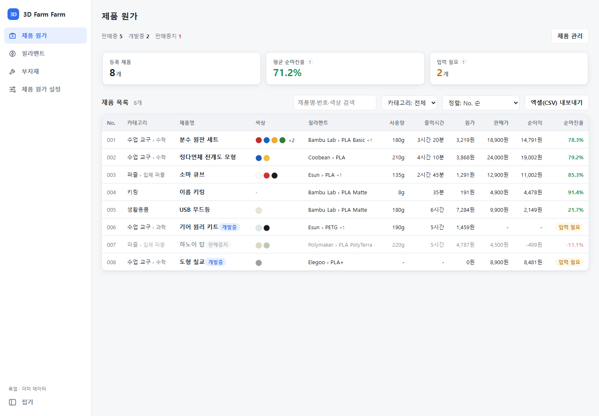
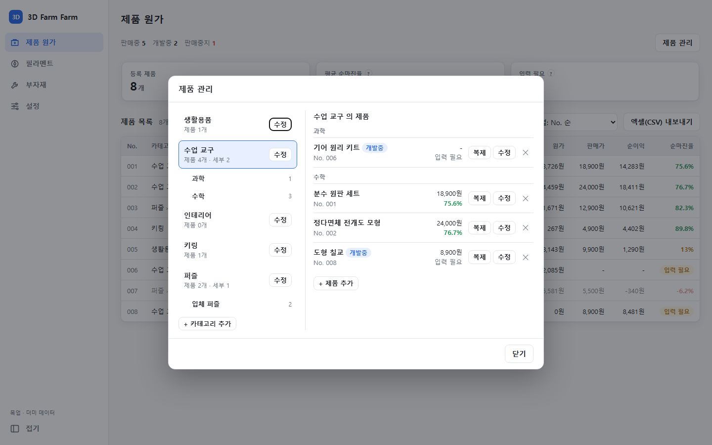
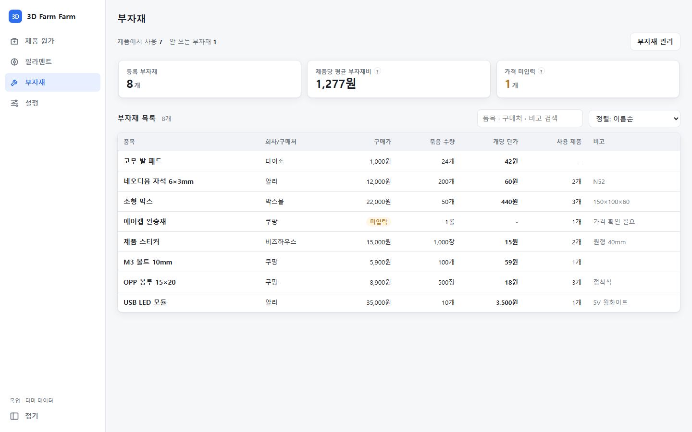
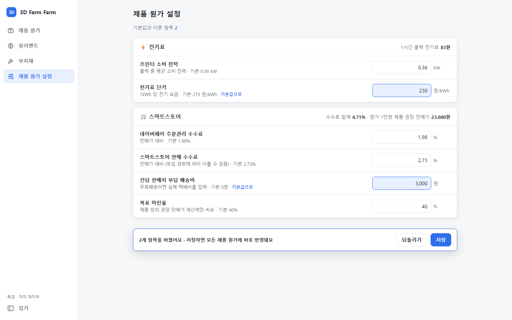
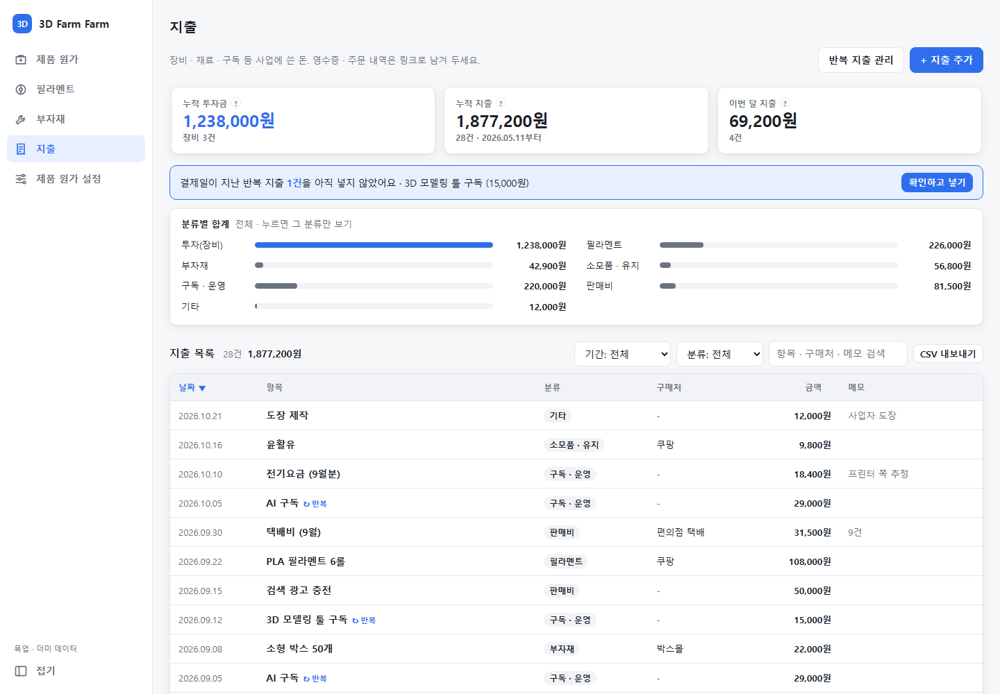
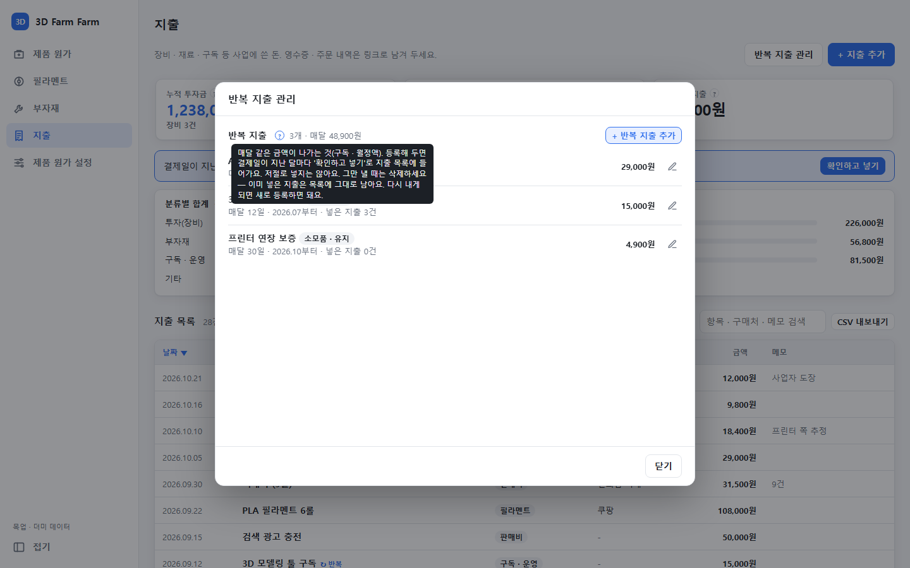

# 화면 구성 — 3D Farm Farm (쓰리디팜팜)

> 요구사항: [PRD.md](PRD.md) · 데이터 구조: [ERD.md](ERD.md)
> 화면 목업: [mockups/](mockups/) — HTML 파일을 브라우저로 열면 더미 데이터로 동작한다.
> 스크린샷: [screens/](screens/) (1440px, 라이트 테마)

| 화면 | 상태 |
|---|---|
| 필라멘트 | ✅ 목업 확정 — [mockups/filaments.html](mockups/filaments.html) |
| 제품 원가 | ✅ 목업 확정 — [mockups/products.html](mockups/products.html) |
| 재고 관리 (v2) | ✅ 목업 확정 — [필라멘트](mockups/filaments.html) · [부속품](mockups/parts.html) · [포장](mockups/packaging.html) · [소모품](mockups/consumables.html) |
| 설정 | ✅ 목업 확정 — [mockups/settings.html](mockups/settings.html) |
| 지출 | ✅ 목업 확정 — [mockups/expenses.html](mockups/expenses.html) |
| QR 스풀 관리 (v2) | ✅ 목업 확정 · 구현 — [mockups/qr.html](mockups/qr.html) (1.10 · 1.11) |
| 손익 (v2) | ✅ 목업 확정 · 구현 — [mockups/pl.html](mockups/pl.html) (7장) |
| 스마트스토어 연동 (v2) | ✅ 목업 확정 · 구현 — [mockups/store.html](mockups/store.html) (6.4 · 4장 연결) |

## 메뉴 구조

```
3D Farm Farm (왼쪽 사이드바)
├─ 제품 원가
│   ├─ [모달] 제품 관리 (카테고리 › 세부 분류 / 제품)
│   │   ├─ [모달] 카테고리 추가 / 수정 (세부 분류 포함)
│   │   └─ [모달] 제품 추가 / 복제 / 수정
│   └─ [모달] 제품 수정 (목록 행을 눌러서)
├─ 재고 관리 (v2 — 화면 위 탭: 필라멘트 | 부속품 | 포장 | 소모품)
│   [필라멘트 탭]
│   ├─ [메뉴] 색상 타일 메뉴
│   ├─ [모달] 필라멘트 관리 (회사·필라멘트 / 재질)
│   │   ├─ [모달] 회사 추가 / 수정
│   │   ├─ [모달] 필라멘트 추가 / 수정
│   │   └─ [모달] 재질 추가 / 수정
│   ├─ [모달] 색상 추가 (`+ 색상` 타일)
│   ├─ [모달] 색상 · 스풀 관리 (타일 메뉴 톱니바퀴, 탭: 색상 정보 / 스풀)
│   ├─ [모달] 재고 추가
│   ├─ [모달] 사용 시작할 / 사용 완료할 스풀 선택
│   ├─ QR 스풀 관리 (`QR` 버튼 — 라벨 인쇄, v2 TBD-18)
│   [부속품 · 포장 · 소모품 탭 — 같은 화면을 탭(kind)으로 나눠 씀]
│   ├─ [모달] ○○ 관리 (구매처별 / 카테고리별 → 품목)
│   │   └─ [모달] 품목 추가 / 복제 / 수정
│   ├─ [모달] 품목 수정 (카드 · 행을 눌러서, 입출고 기록 포함)
│   │   └─ [모달] 남은 수량 조정
│   ├─ [모달] 제품의 부속품 바꾸기 (부속품 탭)
│   └─ [모달] 포장 세트 추가 / 수정 (포장 탭)
├─ 판매 (v2)
│   ├─ [모달] 판매 추가 / 복제 / 수정
│   └─ 스마트스토어 연동 (`스마트스토어 가져오기` 버튼, v2 STORE)
│       └─ [모달] 상품 연결
├─ 지출
│   ├─ [모달] 지출 추가 / 복제 / 수정
│   ├─ [모달] 반복 지출 관리
│   │   └─ [모달] 반복 지출 추가 / 수정
│   └─ [모달] 이번 달 반복 지출 넣기
├─ 손익 (v2 — 입력 없음, 기간 고르기 창만)
└─ 설정 (사이드바 맨 아래, `접기` 위)
    ├─ 🧮 제품 원가 (제품 원가 화면 ⚙)
    └─ 🛒 스마트스토어 (판매 화면 ⚙)

폰 스풀 화면 /s/{코드} (QR 라벨을 폰 카메라로 찍으면, 사이드바 없음 — v2 TBD-18)
```

## 공통

| 요소 | 동작 |
|---|---|
| 첫 화면 | 앱을 열면 제품 원가 |
| 사이드바 | 펼치면 아이콘 + 메뉴 이름(220px), `접기` 를 누르면 아이콘만(64px, 마우스를 올리면 이름). 접힘 상태는 브라우저에 기억. 폭 760px 이하에서는 항상 아이콘만 |
| 화면 제목 | 각 화면 맨 위에 화면 이름 |
| 추가·수정 | 대화상자(모달). `닫기`/`취소` 또는 Esc 로 닫힘. 창 머리(제목) · 아래(버튼 줄)는 그대로 두고 본문만 스크롤, 스크롤할 내용이 더 있으면 경계에 옅은 그림자 |
| 관리 창 목록 | 제품 관리 · 필라멘트 관리 · 재고 품목 관리(부속품 · 포장재 · 소모품) · 반복 지출 관리: 목록마다 위에 제목 줄(제목 · 개수 · 오른쪽에 파란 `+ ○○ 추가`)을 두고, 목록은 칸마다 따로 스크롤 (제목 줄은 그대로) (`components/ManageColumn.tsx`). 줄 오른쪽은 `복제` · `수정` 아이콘 묶음 (겹친 네모 · 연필, 같은 크기 · 간격, 마우스를 올리면 파랑, `components/EditButton.tsx`). 아래 문서의 `복제` · `수정` 버튼은 이 아이콘. **목록에는 삭제(✕)를 두지 않고**, 수정 창 왼쪽 아래 `삭제` 로 지운다 (v1.2.0). 필라멘트 제목 타일도 마우스를 올리면 같은 연필 |
| 관리 창 크기 | 제품 관리 · 필라멘트 관리 · 재고 품목 관리(부속품 · 포장재 · 소모품) · 색상 · 스풀 관리 · 반복 지출 관리는 항목 수와 상관없이 높이 고정 (640px, 화면이 작으면 화면 높이까지 — `app.css` `--dlg-fixed-h`). 추가 · 수정 창은 내용만큼 |
| 확인 창 | 브라우저 기본 확인 창이 아니라 앱 대화상자 (`components/Confirm.tsx`, 목업 [common.html](mockups/common.html)). 열린 창 위에 겹쳐 뜨고 Esc · `취소` 로 닫힘. 처음에는 `취소` 에 커서 (Enter 로 실수 삭제 방지). 삭제는 빨간 버튼, 삭제가 아닌 확인(스풀 되돌리기)은 파란 버튼 |
| 알림(토스트) | 화면 하단. 기본 2.2초, `되돌리기` · 바로가기 버튼(`라벨 인쇄`)이 있으면 7초 |
| 삭제 확인 | **그것만 지워지는 삭제**: 확인 문구 한 번 (`○○ 을 삭제할까요?` → `삭제`) |
|  | **다른 데이터도 함께 지워지거나 바뀌는 삭제** (색상을 지우면 스풀도 삭제 · 제품 줄의 색상이 비워짐 등): 경고 창에 무엇이 몇 개 지워지거나 바뀌는지 하나씩 따로 묶어 적고 (굵은 제목 `스풀 5개도 함께 삭제` + 아래 내용), **2차 확인** — `삭제` 를 누르면 같은 창에서 버튼이 빨간 `정말 삭제` 로 바뀌고, 한 번 더 눌러야 실행. 브라우저 기본 확인 창이 아니라 대화상자로 (예: 색상 삭제, PRD FIL-09) |
| 상태 색 | 재고 없음 = 주황 · 소진 = 빨강 · 사용 중 숫자 = 파랑 |
| 테마 | 사이드바 아래(`접기` 위) `시스템` · `라이트` · `다크`. 기본 시스템, 고른 값은 브라우저에 기억. 사이드바를 접으면 지금 테마 아이콘 하나 (누를 때마다 다음 테마) |
| 열 제목 정렬 | 표 목록(제품 · 재고 품목)은 열 제목을 누르면 그 열로 정렬, 한 번 더 누르면 반대 방향. 정렬된 열은 파란 글자 + ▲/▼. 금액 · 개수 열은 처음에 큰 순. 값이 없는 것(입력 필요 · 미입력)은 방향과 상관없이 맨 뒤 |

---

## 1. 필라멘트


<details><summary>다크 테마</summary>


</details>

화면은 위에서부터 **전체 요약 → 회사별 요약 → 필라멘트 목록** 순서다.

### 1.1 전체 요약 (맨 위 한 줄)

| 항목 | 규칙 |
|---|---|
| `재고 스풀` · `사용 중` | 전체 스풀 수 |
| `재고 없는 색상` | 재고 0개 + 사용 중 1개 이상인 색상 수. 숫자만 주황 |
| `소진된 색상` | 재고·사용 중 모두 0개인 색상 수. 숫자만 빨강 |
| `QR` · `필라멘트 관리` | 오른쪽 끝 버튼 → QR 스풀 관리 (1.10) · 필라멘트 관리 모달 |

- 작은 글씨 한 줄. 검색·필터와 상관없이 항상 전체 기준.

### 1.2 회사별 요약

| 항목 | 규칙 |
|---|---|
| 표시 대상 · 순서 | 등록된 **모든 회사**, 사용량(사용 중 + 사용 완료 kg) 많은 순 → 같으면 이름순. 검색·필터와 무관 |
| 카드 | 고정 크기 260×124. 대표 이미지(없으면 첫 글자) · 회사 이름 · 오른쪽에 보유량(재고 + 사용 중 kg) |
| 막대 | 재고(진한 파랑) · 사용 중(연한 파랑) · 사용 완료(회색) 무게 비율. 아래에 상태별 kg |
| 클릭 | 카드 어디든 누르면 필라멘트 목록을 그 회사로 필터 (선택된 카드는 파란 테두리). 다시 누르면 해제 |
| 배치 | 한 줄에 다 들어가면 1줄, 넘치면 **2줄로 나누고 가로로 슬라이드** |
| 넘기기 | 스크롤바는 숨김. 좌우 `‹` `›` 버튼(넘길 수 있을 때만 표시), 마우스로 끌기, 휠 |

### 1.3 필라멘트 목록


**제목 줄**: `필라멘트 목록 N개` + 오른쪽에 검색 · 회사 필터 · 재질 필터 · 정렬 (+ 조건이 있으면 `필터 지우기`)

| 도구 | 규칙 |
|---|---|
| 검색 | 회사 · 재질 · 시리즈 · 색상 이름. 색상 이름으로 찾으면 그 색상 타일만 표시 |
| 필터 | 회사 / 재질 (전체 또는 하나) |
| 정렬 | 회사 이름순 · 재고 많은 순(재고 + 사용 중 kg) · 재고 적은 순 · 전체 많은 순 |
| 적용 범위 | **목록에만** 적용 (전체 요약 · 회사별 요약은 그대로) |

**필라멘트 묶음** — 필라멘트마다 카드 하나. 안의 칸은 모두 같은 크기(190×150)이고 넘치면 아래로 줄바꿈한다.

| 칸 | 내용 |
|---|---|
| 제목 타일 (첫 칸) | 연한 파란 배경 + 왼쪽 강조선. 로고 · 회사 · 필라멘트 이름(재질 + 시리즈) · 스풀 가격(`14,400원 / 1kg`, 없으면 회색 `가격 미입력`). 마우스를 올리면 보유 스풀 평균 구매가 · 사용 제품 수. 누르면 필라멘트 수정 모달 (마우스를 올리면 파란 테두리 + `✎`) |
| 색상 타일 | 왼쪽 색 선(색상 코드 색, 얇은 테두리) · 색상 이름 · 상태 배지(재고 없음/소진) · 색상별 가격(있을 때만) · 보유 kg · 막대 · 재고/사용 중/사용 완료 개수 |
| `+ 색상` 타일 | 점선. 누르면 이 필라멘트로 고정된 색상 추가 모달 |

**색상 타일 막대** (그 색상으로 그림)
| 구간 | 모양 |
|---|---|
| 재고 | 그 색 두꺼운 칸 |
| 사용 중 | 그 색을 연하게 한 두꺼운 칸 |
| 사용 완료 | 가는 회색 선 |

- 검정·흰색도 보이도록 칸마다 얇은 테두리, 칸 사이 간격. 스풀이 하나도 없으면 가는 선만.
- 색상 코드(hex)는 타일에 쓰지 않는다 (색상 · 스풀 관리 창과 타일 메뉴에서만 표시).

### 1.4 색상 타일 메뉴


| 항목 | 동작 |
|---|---|
| 머리 | 색 칩(네모) · 색상 이름 · `색상 코드 · 스풀 N개`, 오른쪽 **톱니바퀴** → 색상 · 스풀 관리 모달 (1.6) |
| `재고 추가` (+ 아이콘) | 재고 추가 모달 |
| `사용 중으로` (▷ 아이콘, 재고 N) | 사용 시작할 스풀 선택 모달. 재고 0이면 비활성 |
| `사용 완료로` (✓ 아이콘, 사용 중 N) | 사용 완료할 스풀 선택 모달. 사용 중 0이면 비활성 |

- v1.2.0 (TBD-13): 예전 `⚙ 스풀 조정` · `색상 수정` 두 항목을 머리의 톱니바퀴 하나로 합쳤다

- 타일을 누르면 타일 아래(공간이 없으면 위)에 열림. 다시 누르기 · 바깥 클릭 · Esc · 스크롤로 닫힘.

---

### 1.5 [모달] 필라멘트 관리

| 회사·필라멘트 탭 | 재질 탭 |
|---|---|
|  |  |

| 탭 | 구성 |
|---|---|
| 회사·필라멘트 | 왼쪽 회사 목록(제목 줄 `회사 N` · `+ 회사 추가` / 로고 · 이름 · 필라멘트 수 · `수정`) / 오른쪽 선택한 회사의 필라멘트(제목 줄 `○○ 의 필라멘트 N` · `+ 필라멘트 추가` / 이름 · 색상 수 · 가격 · `복제` · `수정`). 양쪽 목록은 따로 스크롤 |
| 재질 | 재질 목록(제목 줄 `재질 N` · `+ 재질 추가` / 이름 · 사용하는 필라멘트 수 · `수정`) |

| 회사 추가 / 수정 | 필라멘트 추가 / 수정 |
|---|---|
|  |  |

| 대상 | 입력 | 삭제 |
|---|---|---|
| 회사 | 이름* · 대표 이미지(파일 선택 + 미리보기, `이미지 지우기`) | 필라멘트가 있으면 불가 |
| 필라멘트 | 재질*(선택, 목록 끝 `+ 새 재질…`) · 시리즈(선택) · 스풀 가격 · 스풀 무게(기본 1000g). 아래에 표시 이름 미리보기 | 색상이 있거나 제품에서 쓰면 불가 |
| 재질 | 이름*(예: PETG-CF, 중복 불가) | 필라멘트에서 쓰면 불가 |

- 필라멘트 수정은 이 모달 또는 필라멘트 목록의 제목 타일에서.
- `복제`: 값(재질 · 시리즈 · 가격 · 무게)을 복사한 필라멘트 추가 모달. 시리즈는 `원래 시리즈 (복사)`, 창 제목 옆에 회색 `○○에서 복제`. 색상은 복사하지 않음. 저장해야 추가됨
- 필라멘트 삭제는 필라멘트 수정 창의 `삭제`: 색상이 있으면 확인 창 없이 `색상 N개가 있어서 삭제할 수 없어요`. 없으면 확인 후 삭제 (제품에서 쓰면 서버가 막음)

### 1.6 [모달] 색상 추가 / 색상 · 스풀 관리


- **색상 추가**: `+ 색상` 타일에서. 아래 입력칸만 있는 창
- **색상 · 스풀 관리** (TBD-13): 타일 메뉴의 톱니바퀴에서. 넓은 창(높이 고정) 하나에 탭 두 개, 처음에는 `색상 정보` 탭
  - 머리: 그라데이션 띠(색상 이름 · 필라멘트 이름 · 색상 코드) 아래 밑줄 탭 `색상 정보` · `스풀 N`. 스풀 탭이면 탭 줄 오른쪽에 `간단 | 세부`
  - `색상 정보` 탭: 왼쪽 입력칸(아래 표), 오른쪽 이 색상 요약 — 스풀(재고 · 사용 중 · 사용 완료, `스풀 탭에서 보기 →`) · 남은 무게(재고 + 사용 중) · 평균 구매가(재고 + 사용 중) · 쓰는 제품. 아래 `삭제` · `취소` · `저장`
  - `스풀` 탭: 맨 위 `재고 N · 사용 중 N · 사용 완료 N`, 아래는 스풀 조정 표 (1.9). 바꾸면 바로 저장, 아래는 `닫기`
  - 탭을 바꿔도 입력 중인 색상 정보는 그대로

| 항목 | 규칙 |
|---|---|
| 창 머리 | 그 색상의 옅은 그라데이션 띠: 색 칩 · 색상 이름(추가는 `색상 추가`) · 필라멘트 이름 · 색상 코드. 입력 중인 색상 코드를 따라 바로 바뀜 |
| 회사* · 필라멘트* | 고정(비활성) |
| 색상 이름* | 같은 필라멘트 안에서 중복 불가 |
| 색상 코드* | 글자 입력칸 + 색 미리보기 + 색 선택기. `F5F5F5` / `#f5f5f5` 붙여넣기 허용 → `#F5F5F5` 로 저장. 형식이 틀리면 빨간 안내. 색 선택기로 고르면 입력칸도 채워짐 |
| 가격 | 등록 가격, 비우면 필라멘트 가격 사용. 아래 안내: 보유 스풀이 있으면 `원가 계산은 보유 스풀 평균 17,200원 · 이 가격은 보유 스풀이 없을 때`, 없으면 `비우면 필라멘트 가격 14,400원 사용 · 보유 스풀이 생기면 원가는 그 구매가 평균으로` (v2 PL) |
| 삭제 | 막지 않음. 스풀이 있으면 빨간 묶음 `스풀 N개도 함께 삭제`(상태별 개수), 제품에서 쓰면 주황 묶음 `제품 N개의 색상이 비워짐`(제품 이름 · 필라멘트 가격으로 계산 안내). 하나라도 있으면 2차 확인 (`정말 삭제`), 없으면 한 번 확인. 되돌리기 없음 |

### 1.7 [모달] 재고 추가



수량(1~100) · 구매일(기본 오늘) · 스풀 1개 구매가(기본 색상 가격, 없으면 필라멘트 가격) → `재고에 추가`
- 지출 없이 들어온 스풀(선물 · 예전 재고)용. 아래 안내 `지출 없이 들어온 스풀용 (선물 · 예전 재고). 산 스풀은 지출에 적으면 자동으로 생겨요` (v2 TBD-33)
- 번호는 항상 다음 번호부터 (번호 지정 없음, 지운 번호는 다시 안 씀)
→ 알림에 생성된 스풀 코드 범위(`S00041 ~ S00043`) + `되돌리기` + `라벨 인쇄`(만든 스풀을 골라 둔 QR 스풀 관리, 1.10)

### 1.8 [모달] 사용 시작할 / 사용 완료할 스풀 선택



- 좁은 창. 해당 상태의 스풀 목록: 코드 + 구매일(또는 사용 시작일). 줄을 누르면 바로 처리하고 닫힘 → 알림 + `되돌리기`
- 10개씩 페이지 넘김 (`« ‹ 1 2 3 4 5 › »`)

### 1.9 스풀 조정 (색상 · 스풀 관리의 스풀 탭)

| 간단 | 세부 |
|---|---|
|  |  |

| 보기 | 열 | 동작 |
|---|---|---|
| 간단 | 스풀 · 구매일 · 구매가 입력 · `재고` `사용 중` `사용 완료` | 현재 상태 버튼은 회색·비활성. 거꾸로 이동(사용 완료 → 사용 중 등)은 확인 문구. 구매가는 입력 즉시 저장. 지출로 생긴 스풀은 입력칸 대신 `14,400원` `지출` (툴팁 `구매가는 지출에서 고쳐요`) |
| 세부 | 스풀 · 상태 · 구매일 · 사용 시작일 · 사용 완료일 · 구매가 입력 · ✕ | ✕ = 스풀 삭제(확인 문구 · 분실 · 불량, 지출은 그대로) → 알림 + `되돌리기`(같은 번호 · 주문으로) |

- 오른쪽 위 `간단 | 세부` 전환. 창 높이 고정, 10개씩 페이지 넘김.
- 상태를 바꿔도 창은 열린 채 같은 페이지에 머문다. 알림의 `되돌리기` 를 누르면 창도 갱신.

### 1.10 QR 스풀 관리 — 라벨 인쇄 (v2 TBD-18)

> 목업: [mockups/qr.html](mockups/qr.html) 왼쪽 (오른쪽은 1.11)

필라멘트 화면의 `QR` 버튼 → 탭 아래 `‹ 필라멘트` · `QR 스풀 관리` (사이드바 · 탭은 그대로, `‹ 필라멘트` 나 탭을 누르면 돌아감). **이미 등록된 스풀로만** 인쇄한다 (번호 예약 · 새 라벨 없음).

| 요소 | 동작 |
|---|---|
| 머리 | `라벨 인쇄` + `라벨 없음 N`(기본 — 라벨을 안 뽑은 재고 · 사용 중 스풀) · `전체 · 다시 인쇄`(모든 스풀) |
| 골라 둔 스풀 | 지출 저장 · 재고 추가 알림의 `라벨 인쇄` 로 오면 그 스풀을 골라 둔 채로, 위에 `방금 저장한 지출 PLA Basic 10롤의 스풀 · 10개 골라 뒀어요` (지출은 그 지출의 스풀 중 라벨 없는 것) |
| 검색 · 크기 | 코드 · 색상 · 필라멘트 검색. 크기 `40 × 30 mm` · `50 × 30 mm`(라벨 프린터) · `A4 라벨지 24칸`(일반 프린터) — 고른 크기는 브라우저에 기억 |
| 스풀 목록 | 새 번호 먼저, 칸 안에서 스크롤 (제목 줄 고정). 줄: 체크 · 코드 · 색 동그라미 · 색상 이름 + 필라멘트(지출로 생긴 스풀은 `· 주문 2026.10.27`) · `라벨 없음`(주황) · 상태. 제목 줄 체크 = 보이는 것(검색 결과) 모두 고르기 / 풀기, 일부만이면 반쯤 |
| 미리보기 | 고른 라벨 11장까지 + `외 N장`. 라벨 = QR + 코드 + 색상 · 재질 시리즈 + 회사 (같은 색 스풀은 아무 라벨이나 붙여도 됨) |
| QR 안의 주소 | `{PUBLIC_URL}/s/S00101` + (?) 설명. `PUBLIC_URL` 이 없어 `localhost` 주소가 되면 주황 `폰에서 안 열림 · backend/.env 에 PUBLIC_URL` |
| 아래 | `N장 고름` · `모두 풀기` · 파란 `N장 인쇄` → 브라우저 인쇄 창 (라벨만 인쇄 — 라벨 프린터는 한 장 = 한 페이지, A4 는 24칸씩). 창을 닫으면 그 스풀은 `라벨 뽑음` → 알림 `N장 인쇄했어요 (S00101 ~ S00110)` + `되돌리기`(인쇄를 취소했을 때) |

- 인쇄 창의 프린터 · 용지는 브라우저에서 고른다 (라벨 프린터 드라이버의 용지 크기를 라벨 크기와 맞출 것). A4 라벨지 칸 위치(64 × 33.9mm, 위 13mm · 왼쪽 6.5mm)는 라벨지마다 조금씩 다를 수 있음

### 1.11 폰 스풀 화면 (v2 TBD-18)

> 목업: [mockups/qr.html](mockups/qr.html) 오른쪽

폰 기본 카메라로 라벨을 찍으면 열리는 `{PUBLIC_URL}/s/{코드}` (앱 설치 없음, 사이드바 없이 이 스풀 하나). **상태 바꾸기 전용** — 등록 · 정보 고치기는 PC 에서.

| 요소 | 동작 |
|---|---|
| 위 | `3D Farm Farm · 스풀`, 코드(크게) + 상태 |
| 카드 | 색 동그라미 · 색상 이름 · 필라멘트, 구매가 · 구매일(지출로 생긴 스풀은 `· 지출 이름`) · 사용 시작 · 사용 완료 |
| 큰 버튼 | 재고 → `사용 시작` / 사용 중 → `사용 완료` + 아래 `오늘(2026.11.14) 날짜로 기록돼요`. 사용 완료는 버튼 없이 `다 쓴 스풀이에요. 라벨은 떼서 버려도 돼요.` |
| 되돌리기 링크 | 사용 중 → `재고로 되돌리기` / 사용 완료 → `사용 중으로 되돌리기` |
| 바꾼 뒤 | 위에 초록 `✓ 사용 시작으로 바꿨어요` (날짜 규칙은 PRD 3.4 그대로) |
| 없는 코드 | 지운 스풀 · 잘못 찍힘: 빨간 `등록된 스풀이 아니에요.` + `지운 스풀의 라벨이거나 잘못 찍혔을 수 있어요. 라벨은 떼서 버려도 돼요.` |

---

## 2. 제품 원가



<details><summary>다크 테마</summary>


</details>

화면은 위에서부터 **상태별 개수 → 요약 카드 → 제품 목록** 순서다. 배치 · 간격은 필라멘트 화면과 같다.

### 2.1 상태별 개수 (맨 위 한 줄)

| 항목 | 규칙 |
|---|---|
| `판매중` · `개발중` · `판매중지` | 상태별 제품 수. 판매중지가 1개 이상이면 숫자만 빨강 |
| `입력 필요 N` | 입력이 덜 된 제품 수 (주황 글자 버튼). 누르면 그 제품만 목록에 보기 (켜지면 주황 바탕, 다시 누르면 해제). 0개면 회색 |
| `제품 관리` | 오른쪽 버튼 → 제품 관리 모달 |
| `⚙` | 오른쪽 끝 → `설정 › 제품 원가` (4장) |

- 작은 글씨 한 줄 (필라멘트 화면의 전체 요약과 같은 모양). 검색 · 필터와 상관없이 항상 전체 기준.

### 2.2 요약 카드

| 카드 | 규칙 |
|---|---|
| 등록 제품 | 전체 제품 수 |
| 평균 순마진율 | **판매중이고 입력이 끝난 제품만** 평균. 색은 순마진율 색 규칙 |

- 설명 문구는 카드에 쓰지 않고 카드 제목 옆 `(?)` 에 마우스를 올리면 위로 표시 (`판매중이고 입력이 끝난 제품 5개 기준 · 수수료 반영` 등).
- 카드 2개는 같은 높이, 내용은 위에서부터.

### 2.3 제품 목록

**제목 줄**: `제품 목록 N개` + 오른쪽에 검색 · 카테고리 필터 (+ 조건이 있으면 `필터 지우기`) · `엑셀(CSV) 내보내기`

| 도구 | 규칙 |
|---|---|
| 검색 | 제품명 · No. · 색상 이름 |
| 카테고리 필터 | `카테고리: 전체` / 카테고리 / 그 아래 세부 분류(들여쓰기) |
| 정렬 | 열 제목 (공통). 기본 No. 순. No. · 제품명 · 사용량 · 출력시간 · 원가 · 판매가 · 순이익 · 순마진율 (순마진율은 처음에 낮은 순). 입력이 덜 된 제품은 순이익 · 순마진율 정렬에서 맨 뒤 |
| 엑셀(CSV) 내보내기 | 제품별 원가 내역 CSV (UTF-8 BOM). 검색 · 필터와 상관없이 전체 |

**제품 표** — 행을 누르면 제품 수정 모달.

| 열 | 내용 |
|---|---|
| No. · 카테고리 | No. 는 5자리까지 보이고, 더 길면 `123…` 으로 줄이고 마우스를 올리면 전체 (TBD-12). 카테고리는 `수업 교구 › 수학` (세부 분류는 회색). 없으면 회색 `미분류` |
| 제품명 | 굵게 + 상태 배지 (판매중은 배지 없음, 개발중 파랑 · 판매중지 회색). 판매중지 행은 흐리게 |
| 색상 | 사용 필라멘트 줄에서 고른 색상의 색 동그라미 (같은 색상은 한 번, 얇은 테두리). 5개가 넘으면 4개 + `+N`. 마우스를 올리면 색상 이름 전체 |
| 필라멘트 | 첫 필라멘트 이름 + `+N`. 마우스를 올리면 전체 (필라멘트 · 색상 · 사용량) |
| 사용량 · 출력시간 · 원가 · 판매가 · 순이익 | 제품 1개 기준 |
| 순마진율 | 0% 미만 빨강 / 20% 미만 주황 / 그 외 초록. 입력이 덜 된 제품은 숫자 대신 주황 `입력 필요` 배지 (마우스를 올리면 빠진 항목) |

### 2.4 [모달] 제품 관리

| 제품 관리 | 카테고리 수정 |
|---|---|
|  |  |

필라멘트 관리와 같은 2단 구조. 카테고리 관리와 제품 추가 · 복제를 여기서 한다.

| 영역 | 구성 |
|---|---|
| 왼쪽 | 제목 줄 `카테고리 N` · `+ 카테고리 추가`. 카테고리마다 한 묶음 (이름순, 묶음 사이 구분선): 카테고리는 굵게 · `제품 N개 · 세부 N` · `수정`, 그 아래 세부 분류는 세로선으로 들여 쓰고 가늘게 (이름 · 제품 수 알약). 카테고리가 없는 제품이 있으면 맨 아래 회색 `미분류` |
| 오른쪽 | 처음엔 `전체 제품` (카테고리별로 묶어서). 카테고리(또는 세부 분류)를 고르면 그것의 제품, 카테고리를 고르면 세부 분류별로 묶어서 표시. **고른 것을 다시 누르면 선택이 풀리고 전체로**. 줄: 제품명 · 상태 배지 · No. · 판매가 · 순마진율(또는 `입력 필요`) · `복제` `수정`. 제목 줄 `+ 제품 추가` |

| 동작 | 규칙 |
|---|---|
| `+ 제품 추가` | 제품 추가 모달 (지금 고른 카테고리 · 세부 분류가 미리 선택됨, 전체면 미분류) |
| `복제` | 재료(필라멘트 · 색상 · 부속품)까지 복사한 제품 추가 모달. No. 는 다음 번호, 이름은 `원래 이름 (복사)`, 상태는 개발중. 저장해야 추가됨 |
| 삭제 | 제품 수정 창의 `삭제` (확인 문구 후 삭제) |
| 카테고리 추가 / 수정 | 좁은 창: 카테고리 이름* + 세부 분류 목록(이름 · 제품 수 · ✕, `+ 세부 분류 추가`). 세부 분류는 필요할 때만 |
| 삭제 제한 | 제품이 있는 카테고리 · 세부 분류는 삭제 불가 (세부 분류 ✕ 도 막음). 이름은 카테고리 전체에서, 세부 분류는 카테고리 안에서 중복 불가 |

- 추가 · 수정 · 복제 창은 제품 관리 창 위에 겹쳐 열리고, 저장하면 관리 창과 목록이 함께 갱신된다.

### 2.5 [모달] 제품 추가 / 수정


넓은 창. 창 제목은 따로 없고 맨 위 머리 띠의 제품명이 제목.

| 영역 | 내용 |
|---|---|
| 머리 띠 (옅은 파랑) | 윗줄: `No. 1` · (추가면 파란 `새 제품` 배지, 복제면 회색 `○○에서 복제`) · 오른쪽에 상태 알약 버튼 `판매중` `개발중` `판매중지` (점 + 이름, 판매중 초록 · 개발중 파랑 · 판매중지 회색). 가운데: 제품명* 크게. 아래: `카테고리 › 세부 분류` 선택 (`미분류` · 카테고리들 · `+ 새 카테고리…`, 세부 분류가 없으면 비활성) |
| 왼쪽: 사용 필라멘트 (1개 기준) | 표: 필라멘트 · 색상(색 동그라미 + 선택, `색상 선택 안 함` 가능) · 사용량(g, 소수 2자리까지) · 금액 · ✕. 표 맨 아래 점선 줄 `+ 필라멘트 추가` (누르면 그 자리에 새 줄, 비어 있으면 이 줄만) |
| 왼쪽: 사용 부속품 (1개 기준) | 표: 부속품 · 수량(부속품 단위) · 금액 · ✕. 제목 줄 오른쪽 `+ 다른 제품에서`, 표 맨 아래 점선 줄 `+ 부속품 추가` |
| 왼쪽: 기본 포장 (v2) | `[포장 세트 고르기]` + 구성(`박스 1 · 에어캡 1`). 1개 보낼 때의 포장 → 원가의 포장비. 안 고르면 주황 `고르지 않으면 포장비 0원 · 입력 필요`. 표의 부속품은 `부속품` 탭 품목만 |
| 합계 줄 (표 아래) | 구분선 + 옅은 배경. 왼쪽에 `필라멘트 N개 · 180.57g` / `부속품 N개`, 오른쪽에 굵은 `합계 2,216원` |
| `+ 다른 제품에서` | 창: 왼쪽 부속품를 쓰는 다른 제품 목록, 오른쪽 고른 제품의 부속품 미리보기. `부속품 N종 넣기` → 항목만 넣고 수량은 빈칸(주황, 첫 새 줄 수량 칸에 커서). 이미 있는 부속품는 `이미 있음 · 건너뜀` (모두 있으면 버튼 비활성) |
| 왼쪽: 메모 | 여러 줄 |
| 오른쪽 위: 원가 입력 | 출력 시간(시 + 분) · 판매가 |
| 오른쪽: 원가 내역 (실시간) | 필라멘트비(총 g) · 전기료 · 부속품비 · 포장비(세트 이름) → **원가** / 판매가 · 수수료 · 배송비* → **순이익** · 순마진율(다른 줄과 같은 모양) / 목표 마진율 기준 권장 판매가 + `판매가로` / 입력 경고 목록 |
| 부속품비 카테고리별 | 부속품비 아래 작은 회색 `부품 720원 · 포장재 18원 · 미분류 15원` (카테고리가 2개 이상일 때만). 목록 원가 열은 합계 그대로 |
| 계산식 `(?)` | 전기료 · 원가 · 수수료 · 순이익 · 순마진율 · 권장 판매가 옆. 마우스를 올리면 그 줄 위에 그 제품 값으로 계산식 (예: `3시간 20분 × 0.36kW × 215원/kWh = 258원`). 필라멘트비 · 부속품비는 왼쪽 표에 줄마다 금액이 있어 생략. 판매가가 없으면 수수료 · 순이익 · 순마진율 식은 숨김 |

\* 0원이면 숨김. 아래 버튼: `삭제`(수정 시) · `취소` · `저장`

| 규칙 | 내용 |
|---|---|
| 재료 줄 | 한 항목 = 한 줄. 끝에 그 줄 금액. g당 단가 · 개당 단가는 금액에 마우스를 올리면 (`색상 가격 15,000원 / 1000g · g당 15.0원`). 가격이 없으면 주황 `가격 없음` + 선택칸 주황 테두리 |
| 색상 · 가격 | 필라멘트 줄의 금액은 고른 색상의 가격 기준 (색상 가격이 없거나 색상을 안 고르면 필라멘트 가격). 필라멘트를 바꾸면 색상은 `색상 선택 안 함` 으로 |
| 입력 칸 모양 | No. · 카테고리 · 세부 분류는 평소엔 글자처럼, 마우스를 올리면 테두리 |
| 입력 경고 (= "입력 필요") | 필라멘트 사용량 · 출력 시간 · 판매가 · 기본 포장 미입력, 필라멘트 · 부속품 · 포장재 가격 미입력 |
| No. | 추가 · 복제 시 다음 번호 자동. 중복이면 저장 거부 |

## 3. 재고 관리 (v2 STOCK) — 부속품 · 포장 · 소모품 탭

사이드바 `재고 관리` 하나 (누르면 필라멘트 탭). 화면 위 탭 `필라멘트 | 부속품 | 포장 | 소모품` — 필라멘트 탭은 1장 그대로.
나머지 세 탭은 같은 화면을 품목 종류(kind)로 나눠 쓴다 (`pages/stock/ItemsTab.tsx`). 아래 3.1 ~ 3.6 은 부속품 탭 기준이고, 포장 · 소모품 탭의 다른 점은 3.8 · 3.9.
남은 수량은 처음 등록 · 조정(3.7) · 판매 저장(6.3) · 다 씀(3.9)으로 바뀌고, 바뀔 때마다 입출고 기록이 한 줄 남는다.

### 부속품 탭



<details><summary>다크 테마</summary>


</details>

화면은 제품 원가와 같은 **사용 여부 개수 → 요약 카드 → 부속품 목록** 순서다.

### 3.1 사용 여부 개수 (맨 위 한 줄)

| 항목 | 규칙 |
|---|---|
| `제품에서 사용` · `안 쓰는 부속품` | 제품에서 쓰는 / 안 쓰는 부속품 수 |
| `제품의 부속품 바꾸기` | 오른쪽 버튼 → 바꾸기 모달 (3.6) |
| `부속품 관리` | 오른쪽 끝 버튼 → 부속품 관리 모달 |

- 작은 글씨 한 줄. 검색 · 필터와 상관없이 항상 전체 기준.

### 3.2 요약 카드

| 카드 | 규칙 |
|---|---|
| 등록 부속품 | 전체 부속품 수 |
| 제품당 평균 부속품비 | **판매중이고 부속품를 쓰는 제품만** 제품 1개의 부속품비 평균. 가격 미입력 부속품는 0원 |
| 가격 미입력 | 가격이 없는 부속품 수(주황). 누르면 그 부속품만 목록에 보기 (선택된 카드는 파란 테두리, 다시 누르면 해제) |

- 설명 문구는 제품 원가처럼 카드 제목 옆 `(?)` 에 마우스를 올리면 표시.

### 3.3 부속품 목록

**제목 줄**: `부속품 목록 N개` + 오른쪽에 검색 · 카테고리 필터(`카테고리: 전체` · 카테고리들 · `미분류`) (+ 조건이 있으면 `필터 지우기`)

| 도구 | 규칙 |
|---|---|
| 검색 | 품목 · 구매처 · 비고 |
| 정렬 | 열 제목 (공통). 기본 품목 이름순. 비고 말고 모든 열. 가격 미입력은 구매가 · 개당 단가 정렬에서, 구매처가 없으면 구매처 정렬에서 맨 뒤 |

**보기**: 오른쪽 `카드 | 표` (탭마다 브라우저에 기억).
- **카드 (기본)**: 카테고리별 묶음. 묶음 맨 위 제목 띠(옅은 바탕 · 왼쪽 파란 막대 · 큰 이름 · `부속품 N개` · 주황 `부족 · 없음 N`) + 사진 타일
  (폭에 맞춰 늘어남, 최소 168px). 타일: 사진(없으면 첫 글자 + `사진 없음`) · 오른쪽 위 `부족`/`없음` 배지 · 왼쪽 위 `구매` · 이름(2줄) ·
  `구매처 · 제품 N개` · 남은 수량(크게, 부족 주황 · 없음 빨강) · 개당 단가. 묶음 끝 점선 `+ 부속품` 타일(그 카테고리로 추가, 필터 중엔 숨김)
- **표**: 아래 열 + `남은 수량`

**부속품 표** — 행을 누르면 부속품 수정 모달.

| 열 | 내용 |
|---|---|
| 품목 | 굵게. 구매 링크가 있으면 옆에 작은 `🔗 구매` 버튼 → 새 탭 (행을 누르는 수정 창과 겹치지 않음) |
| 카테고리 | 이름 배지. 없으면 회색 `미분류` |
| 회사/구매처 | 없으면 `-` |
| 구매가 | 묶음 전체 가격. 없으면 주황 `미입력` 배지 |
| 묶음 수량 | 단위 포함 (`200개`, `500장`) |
| 개당 단가 | 구매가 ÷ 묶음 수량, 굵게. 10원 미만은 소수 1자리 |
| 남은 수량 | 단위 포함, 부족 주황 · 없음 빨강 (품목 옆에도 배지) |
| 사용 제품 | 쓰는 제품 수. 마우스를 올리면 제품 이름 · 수량. 안 쓰면 `-` |
| 비고 | 회색, 길면 줄임 (마우스를 올리면 전체) |

### 3.4 [모달] 부속품 관리

| 부속품 관리 | 부속품 수정 |
|---|---|
|  |  |

제품 관리와 같은 2단 구조. 부속품 추가 · 복제를 여기서 한다 (삭제는 부속품 수정 창). 창 제목 줄 오른쪽에서 `구매처별` / `카테고리별` 보기 전환.

| 영역 | 구성 |
|---|---|
| 왼쪽 (구매처별) | 제목 줄 `구매처 N`. 구매처 목록 (이름순): 구매처 · `부속품 N개`. 구매처가 없는 부속품가 있으면 회색 `구매처 없음` |
| 왼쪽 (카테고리별) | 제목 줄 `카테고리 N` · `+ 추가`. 카테고리 (이름순, `수정`) + 회색 `미분류` |
| 오른쪽 | 제목 줄 `○○ 의 부속품 N` · `+ 부속품 추가`. 처음엔 `전체 부속품`, 왼쪽에서 고르면 고른 것의 부속품 (이름순). **고른 것을 다시 누르면 전체로** (제품 관리와 같음, `전체` 항목은 따로 두지 않음). 줄: 품목(+ `구매` 버튼) · 카테고리(구매처별) 또는 구매처(카테고리별) · `제품 N개에서 사용` · 개당 단가(또는 주황 `가격 미입력`) · `복제` `수정` |

| 동작 | 규칙 |
|---|---|
| `+ 부속품 추가` | 부속품 추가 모달 (지금 고른 구매처 또는 카테고리가 미리 채워짐) |
| 카테고리 `+ 추가` · `수정` | 카테고리 창: 이름* · `부속품 N개`. 삭제하면 그 부속품는 미분류 — 부속품가 있으면 주황 `부속품 N개가 미분류가 돼요`(이름 목록)와 함께 2차 확인 |
| `복제` | 값을 복사한 부속품 추가 모달. 이름은 `원래 이름 (복사)`, 창 제목 옆에 회색 `○○에서 복제`. 사용하는 제품은 복사하지 않음. 저장해야 추가됨 |
| 삭제 | 부속품 수정 창의 `삭제` (제품에서 쓰면 비활성, 아니면 확인 문구 후 삭제) |

- 추가 · 수정 · 복제 창은 관리 창 위에 겹쳐 열리고, 저장하면 관리 창과 목록이 함께 갱신된다.

### 3.5 [모달] 부속품 추가 / 수정

| 항목 | 내용 |
|---|---|
| 창 제목 | `부속품 수정` / `부속품 추가` (+ 파란 `새 부속품` 배지, 복제면 회색 `○○에서 복제`) |
| 입력 | 품목* · 카테고리(`미분류` · 카테고리들 · `+ 새 카테고리…`) · 회사/구매처 · 구매 링크(https:// 주소, 틀리면 빨간 안내) · 구매가(묶음 전체, 비우면 미입력 · 아래 `지출에 이 부속품을 넣으면 그 뒤로는 평균 단가로`) · 묶음 수량 · 단위(기본 `개`, 개 · 장 · 롤 · 세트 · m · g 자동완성) · 비고 |
| 단가 미리보기 | `12,000원 ÷ 200개` → `개당 60원`. 수정 중 단가가 바뀌면 이전 단가를 줄 그어 함께. 가격이 없으면 주황 `가격 미입력 · 원가에 0원` |
| 지출로 산 품목 (v2 PL) | 구매가 · 묶음 수량 칸 대신 `단위` 칸 + 회색 상자 `지출로 산 품목 — 남은 재고와 새로 산 것을 섞은 평균 (지출에서 바뀌어요)` · `평균 개당 150원`. 표의 구매가 칸은 회색 `지출`, 묶음 수량 칸은 `-` |
| 사진 | 120px 칸 + `사진 넣기`/`사진 바꾸기` · `사진 빼기` (png · jpg · webp, 서버가 512px 안으로 줄임). 저장할 때 올림 |
| 남은 수량 | 추가: `지금 가진 수량` 입력 (입출고 기록 `조정 · 처음 수량`). 수정: 지금 수량 + `조정` 버튼 (3.7) |
| 부족 알림 기준 | 이 값 이하면 `부족` (기본 0) |
| 입출고 기록 (수정 시) | 최근순: 날짜 · `지출`/`판매`/`다 씀`/`조정` 배지 · 설명 · ± 수량(늘면 초록, 줄면 빨강) · `→ 그 뒤 남은 수량` |
| 사용하는 제품 (수정 시) | 제품 · 상태 배지 · 수량 · 제품 1개당 이 부속품 금액. 가격을 바꾸면 `720원 → 900원` (오르면 빨강, 내리면 초록) |
| 버튼 | `삭제`(수정 시) · `취소` · `저장`. 제품에서 쓰면 `삭제` 비활성 + `제품에서 쓰는 중이라 삭제 불가` |

- 품목 이름은 중복 불가.
- 저장하면 이 부속품를 쓰는 제품 원가에 바로 반영 (가격이 바뀌었으면 알림에 `제품 N개 원가에 바로 반영돼요`).

### 3.6 [모달] 제품의 부속품 바꾸기

| 항목 | 내용 |
|---|---|
| 안내 | 제품에서 쓰는 부속품를 다른 부속품로 한 번에 바꿔요. 부속품 자체는 지워지거나 바뀌지 않아요 |
| 지금 쓰는 부속품* · 바꿀 부속품* | 지금: 제품에서 쓰는 부속품만 (`· 제품 N개`). 바꿀: 지금 것 말고 전부 (단위가 다르면 이름 옆 단위) |
| 단위가 다르면 | 주황 안내 `단위가 달라요: 장 → 묶음 … 수량을 확인하세요` |
| 쓰는 제품 목록 | 체크(기본 전부) · 제품 · 상태 배지 · 수량 · 제품 1개당 금액 `18원 → 14원` (오르면 빨강, 내리면 초록). 그 제품에 이미 B 가 있으면 파란 `이미 B 1장 있음 → 합쳐서 2장` |
| 버튼 | 왼쪽 `고른 제품 N개만 바꾸기`(일부 체크를 뺐을 때만) · `취소` · `전부 바꾸기 (N개)`. 누르면 2차 확인 (`바꾸기` → `정말 바꾸기`) |

### 3.7 [모달] 남은 수량 조정

| 항목 | 내용 |
|---|---|
| 방식 | `실제 수량으로 맞추기`(기본, 지금 수량이 채워짐) · `빼기` · `더하기`(1부터) |
| 수량 · 사유 | 사유는 자동완성(재고 실사 · 파손 · 불량 · 샘플 · 시험 출력 · 지출 없이 받음), 입출고 기록에 남음 |
| 미리보기 | `지금 25장 → 22장 (-3)`. 아래 회색 `구매는 지출 장부에서 넣으면 자동으로 더해져요. 여기는 그 밖의 차이만` |

- 맞추기로 같은 수량이면 저장하지 않고 `바뀐 수량 없음`. 남은 수량은 0 아래로도 될 수 있다 (판매를 먼저 넣었을 때 — 막지 않고 `없음` 표시)

### 3.8 포장 탭 — 포장재 · 포장 세트

| 항목 | 내용 |
|---|---|
| 맨 위 | `포장재 N` · `포장 세트 N` · `기본 포장 없는 제품 N` + `포장재 관리` |
| 요약 카드 4개 | 남은 포장재 금액(남은 수량 × 단가) · 부족 · 없음 · 이번 달 판매로 쓴 포장(포장 줄이 있는 이번 달 주문 수) · 바로 쌀 수 있는 세트(세트마다 `이름 N`, 0 이면 빨강) |
| 포장 세트 카드 | 목록 위. 이름 · 세트 원가 / 구성(포장재 · 수량, 모자라면 빨강) / `기본 포장인 제품 N` · `바로 쌀 수 있음 N`. 끝에 점선 `+ 포장 세트 추가` |
| 포장재 목록 | 3.3 과 같음. 타일 · 표의 `제품 N개` 대신 `세트 N개` |

**[모달] 포장 세트 추가 / 수정**: 세트 이름* · 들어가는 포장재 줄(`[포장재 · 단가] [수량] 금액 ✕`, `+ 포장재`) · 세트 원가(1번 쌀 때) · 비고 ·
(수정 시) `기본 포장으로 쓰는 제품 N개` 이름 칩. 같은 포장재 줄은 저장할 때 합침. 기본 포장인 제품이 있으면 `삭제` 비활성.
세트를 고치면 기본 포장인 제품 원가가 바로 바뀐다 (지난 판매는 줄마다 단가를 복사해 둬서 그대로).

### 3.9 소모품 탭

| 항목 | 내용 |
|---|---|
| 맨 위 | `소모품 N` · `카테고리 N` + `소모품 관리` |
| 요약 카드 3개 | 등록 소모품 · 부족 · 없음 · 이번 달 소모품 지출(지출 장부 `소모품` 분류 합계) |
| 안내 | `제품 원가에는 들어가지 않아요. 산 돈은 지출 장부 소모품 으로 손익에 들어가고, 여기서는 남은 개수만 챙겨요.` |
| 타일 · 표 | 사진 아래 오른쪽 `1개 다 씀` 버튼(남은 수량 −1, 0 이하면 비활성) · `다 씀 2026.11.04` (없으면 `다 쓴 기록 없음`). 표는 `구매가` · `평균 단가` · `마지막으로 다 씀` 열 + 줄 끝 `1개 다 씀` |

## 4. 설정


<details><summary>다크 테마</summary>


</details>

| 값을 바꾼 상태 | 틀린 값이 있는 상태 |
|---|---|
|  |  |

설정을 한곳에 모은 화면 (v2 TBD-16). 사이드바 맨 아래 `설정` 하나로 들어오고, 안에서 **왼쪽 분류 | 오른쪽 설정 묶음 → 저장 줄** 로 나눈다. 다른 화면보다 좁게(최대 1080px).
각 화면 위 줄 오른쪽 `⚙` 는 자기 분류로 바로 온다 — 제품 원가 → `설정 › 제품 원가`, 판매 → `설정 › 스마트스토어`. 값은 모두 원가 설정 한 행(`CostSetting`)에 저장한다.

| 분류 | 묶음 | 항목 (기본값) | 제목 줄 오른쪽 계산 예시 |
|---|---|---|---|
| 🧮 제품 원가 | ⚡ 전기료 | 프린터 소비 전력 (0.36 kW) · 전기료 단가 (215 원/kWh) | 1시간 출력 전기료 |
| | 🏷️ 판매가 | 목표 마진율 (40%) | 원가 1만원 제품 권장 판매가 (수수료 + 목표 마진율이 100% 이상이면 주황 `계산 불가`). (?) 에 계산식 |
| 🛒 스마트스토어 | 💳 수수료 · 배송비 | 네이버페이 주문관리 수수료 (1.98%) · 스마트스토어 판매 수수료 (2.73%) · 건당 판매자 부담 배송비 (0원) | 수수료 합계 · 2만원 판매 시 수수료 |

| 요소 | 규칙 |
|---|---|
| 왼쪽 분류 | 아이콘 + 이름. 지금 분류는 파랑, 저장 안 한 변경이 있으면 오른쪽에 파란 점. 좁은 화면에서는 위에 가로 한 줄 |
| 항목 줄 | 왼쪽: 이름(굵게) + 쓰는 화면 표시(수수료 · 배송비는 `제품 원가` `판매`) + 설명 한 줄 · `기본 N` (기본값과 다르면 `기본값으로` 버튼). 오른쪽: 입력칸(오른쪽 정렬) + 단위 |
| 입력칸 | 바꾼 칸은 파란 배경. 틀린 칸은 빨간 테두리 + 칸 아래 빨간 문구 (`100 이하로 입력하세요` 등, 앱 공통 문구). 천 단위 쉼표 허용 |
| 입력 범위 | 서버와 같게: 소비 전력 0 이상 · 소수 3자리, 전기료 단가 0 이상 · 소수 1자리, % 칸 0 ~ 100 · 소수 2자리, 배송비 0 이상 정수 |
| 저장 줄 | **분류마다** (분류 아래에 붙어 있음). `바뀐 내용 없음` / `제품 원가 N개 항목을 바꿨어요 · 저장하면 …`(파란 테두리) / `N개 항목을 고쳐야 저장할 수 있어요`(빨간 테두리) + `되돌리기` · `저장`. 바뀐 게 없거나 틀린 칸이 있으면 `저장` 비활성 |
| 저장 · 되돌리기 | 그 분류 항목만 저장. 알림 `제품 원가 설정을 저장했어요 · 모든 제품 원가에 바로 반영돼요` / `스마트스토어 설정을 저장했어요 · 제품 원가와 새로 넣는 판매의 수수료에 반영돼요 (이미 넣은 판매는 그대로)`. `되돌리기` 는 저장된 값으로 |
| 분류 바꾸기 | 저장 안 한 변경이 있으면 확인 창 `취소` / `저장 안 하고 이동` / `저장하고 이동` (틀린 칸이 있으면 `저장하고 이동` 비활성) |
| 나가기 | 저장하지 않은 값이 있으면 브라우저 확인 |

- 프린터(구매가 · 예상 수명 · 출력 실패율)와 백업은 이 화면에서 뺐다 (장비는 손익의 투자 회수 PL-02 에서)
- 스마트스토어 분류 맨 위 `🔌 연결` 묶음 (v2 STORE-04): 점 · `연결됨` / `연결 안 됨` / `연결 실패`(네이버 오류 문구) · `주문 가져오기 화면` · `연결 확인`(토큰을 새로 받아 봄 → 알림). 아래 회색 상자: 키는 `backend/.env` 의 `NAVER_COMMERCE_KEY_FILE` 이 가리키는 파일에서 읽는다는 안내, 연결이 안 되면 키 파일 · `.env` 예시. 화면에서 키를 넣는 칸은 없다
- 손익 분류는 설정할 게 생기면 추가

## 5. 지출

| 지출 화면 | 반복 지출 관리 |
|---|---|
|  |  |

장비 · 재료 · 구독 등 사업에 쓴 돈 (PRD 3.10). 위에서부터 **요약 카드 → 반복 지출 알림 → 분류별 합계 → 지출 목록** 순서다.
위쪽 줄: 안내 한 줄 · `반복 지출 관리` · `+ 지출 추가`(파랑).

### 5.1 요약 카드 · 분류별 합계

| 요소 | 규칙 |
|---|---|
| 카드 3개 | `누적 투자금`(파란 숫자, `장비` 합계 · 장비 N건) · `누적 지출`(N건 · 처음 날짜부터) · `이번 달 지출`(N건). **기간 필터와 상관없이** 전체 기간 / 이번 달. (?) 에 설명 |
| 반복 지출 알림 | 결제일이 지났는데 이번 달에 안 넣은 반복 지출이 있을 때만 파란 줄 `결제일이 지난 반복 지출 N건을 아직 넣지 않았어요 · 이름, … (합계)` + `확인하고 넣기` |
| 분류별 합계 | 분류 9개를 두 줄로: 이름 · 막대(가장 큰 분류 기준 비율, 장비만 파랑) · 금액(없으면 `-`). **기간 필터를 따름**. 줄을 누르면 그 분류만 보기, 다시 누르면 해제 |

### 5.2 지출 목록

| 요소 | 규칙 |
|---|---|
| 제목 줄 | `지출 목록` · N건 · 보이는 목록 합계 · 기간(이번 달 / 올해 / 전체 / 직접 지정 → 날짜 두 칸) · 분류 · 검색(항목 · 구매처 · 메모) · `필터 지우기`(필터가 있을 때) · `CSV 내보내기`(보이는 목록) |
| 열 | 날짜(`2026.10.21`) · 항목 · 분류(배지, 장비만 파랑) · 구매처 · 금액(굵게) · 메모. 열 제목 정렬 (기본 날짜 최근순, 메모는 정렬 없음) |
| 항목 옆 | 반복 지출에서 넣은 줄은 파란 `↻ 반복`. 구매 항목이 있으면 회색 — 필라멘트 `🧵 6롤`(툴팁에 색상별 롤 수 · 사용한 스풀 수), 품목 `📦 네오디뮴 200개 · 소형 50개`(이름 첫 단어). 툴팁에 전체 이름 |
| 행 클릭 | 지출 수정 창 |
| 빈 목록 | 지출이 없으면 `아직 기록한 지출이 없어요. + 지출 추가로 시작하세요.`, 필터 결과가 없으면 `조건에 맞는 지출이 없어요.` |

### 5.3 [모달] 지출 추가 / 복제 / 수정

| 항목 | 내용 |
|---|---|
| 날짜* · 금액* | 날짜 기본 오늘 (오늘 이후 불가). 금액 1원 이상 정수, 쉼표 허용 |
| 항목* | 예: 필라멘트 건조기 |
| 분류* | 버튼 9개, 3칸 3줄 (`세금` 은 v2 PL-06). 예시는 툴팁 (설명 상자 없음). 분류를 바꾸면 구매 항목은 새로 |
| 구매 (v2 TBD-31 · 33) | 분류가 필라멘트 · 부속품 · 포장재 · 소모품일 때만, 처음에는 빈 항목 하나 (비워도 저장, 소모품은 `구매 (선택)`). 항목: `[색상 · 품목 고르기] [수량 롤·단위] [금액 원] ✕` — 필라멘트는 필라멘트별 묶음의 색상, 그 밖은 그 탭의 품목만. 같은 색상 · 품목도 여러 항목 가능. 금액을 비우면 칸 안에 나눠 넣을 금액이 회색으로. 항목 아래 저장하면 바뀌는 것: 필라멘트 `롤당 18,000원 · 스풀 +4개` (원가는 보유 스풀 평균이라 따로 안 보임, 수정이면 저장된 롤 수와 비교해 `스풀 +1개` / `스풀 −1개` / `스풀 그대로`), 품목 `재고 +200개 · 평균 60원 → 45원`(남은 수량과 섞은 이동평균, 이미 저장된 항목을 고칠 때는 회색 `… 평균 단가 다시 계산`). 아래 `+ 색상 추가` / `+ 품목 추가` · 문제가 있으면 주황 글씨(`여러 가지면 항목마다 금액` · `재고 스풀이 2개라 2롤보다 적게 줄일 수 없어요` 등) · 사용한 스풀이 있으면 `사용한 스풀 N개` — 그 항목은 색상 선택 · ✕ 잠김 |
| 구매처 · 메모 | 구매처는 지금까지 쓴 구매처를 자동 완성 |
| 저장 알림 | `저장했어요` 뒤에 바뀐 것 — `스풀 +4개` / `재고 스풀 2개 지움` · `재고 네오디뮴 +200개`. 스풀이 늘었으면 오른쪽 `라벨 인쇄` → 이 지출의 스풀 중 라벨 없는 것을 골라 둔 QR 스풀 관리 (1.10) |
| 머리 | 수정: 반복 지출에서 넣은 줄이면 `↻ 반복 지출 · 이름` 배지. 복제: `이름에서 복제` |
| 아래 | 수정 창만 왼쪽에 `삭제`(확인 한 번 — 필라멘트면 `재고 스풀 N개도 함께 지워져요`, 사용한 스풀이 있으면 `사용한 스풀 N개가 있어 삭제할 수 없어요`) · `복제`(날짜는 오늘, 반복 지출 연결은 복사 안 함) |

### 5.4 [모달] 반복 지출 관리

| 요소 | 규칙 |
|---|---|
| 제목 줄 | `반복 지출` (?) · 개수 · `+ 반복 지출 추가`. (?) 설명은 아래로 펼침 (창 맨 위라서) |
| 줄 | 이름 · 분류 배지 · `매달 N일 · 2026.06부터 · 넣은 지출 N건` · 금액 · `수정`. 결제일순. 목록 위에 `매달 합계` |
| 삭제 | 수정 창 왼쪽 아래 `삭제`, 확인 한 번: `다음 달부터 알림이 뜨지 않아요. 이미 넣은 지출 N건은 목록에 그대로 남아요.` 해지 달은 두지 않는다 — 그만 낼 때는 삭제, 다시 내면 새로 등록 |
| 추가 / 수정 창 | 이름* · 금액* · 결제일*(매달 1~31일, 말일보다 크면 말일) · 분류*(기본 구독 · 운영) · 시작 달*(기본 이번 달) · 메모. 수정 창에는 `금액을 바꾸면 다음에 넣는 달부터 바뀐 금액으로 들어가요` |

### 5.5 [모달] 이번 달 반복 지출 넣기

| 요소 | 규칙 |
|---|---|
| 줄 | 체크(기본 전부) · 이름 · 분류 · 넣을 날짜(이번 달 결제일) · `평소 N원` · 이번 달 금액 입력칸. 금액을 바꾸면 주황 `이번 달만 다른 금액` (반복 지출 금액은 그대로) |
| 아래 | 왼쪽 `N건 · 합계`, `취소` · `N건 넣기` (체크가 없으면 비활성). 한 번에 넣고 알림 `반복 지출 N건을 넣었어요` |

## 6. 판매 (v2)

> 목업: [mockups/sales.html](mockups/sales.html) · 요구사항: [PRD.md](PRD.md) 3.11 `SALE`

팔린 주문을 기록하는 곳. 위에서부터 **요약 카드 → 제품별 판매 → 판매 목록** 순서다 (지출 화면과 같은 모양).
위쪽 줄: 안내 한 줄 · `스마트스토어 가져오기`(6.4) · `+ 판매 추가`(파랑) · `⚙`(설정 › 스마트스토어).

### 6.1 요약 카드 · 제품별 판매

| 요소 | 규칙 |
|---|---|
| 카드 4개 | `이번 달 매출`(초록 숫자, 판매가 합계 · 주문 N건 · M개) · `이번 달 정산 금액`(수수료 합계) · `이번 달 주문 이익`(판매가 대비 %, 원가 없는 주문은 빼고 `원가 없는 주문 제외`) · `누적 매출`(주문 N건 · M개 · 처음 날짜부터). **기간 필터와 상관없이**. (?) 에 설명 |
| 제품별 판매 | 기간 안에 팔린 제품: 이름 · 막대(가장 큰 제품 기준, 초록) · 수량 · 판매가 합계. 판매가 합계 큰 순. **기간 필터를 따름**. 줄을 누르면 그 제품이 든 주문만, 다시 누르면 해제. 지운 제품은 팔 때 이름으로 묶음 |

### 6.2 판매 목록

| 요소 | 규칙 |
|---|---|
| 제목 줄 | `판매 목록` · N건 · 보이는 목록 판매가 합계 · 기간(지출과 같음) · 판매처 · 검색(제품 · 주문번호 · 메모) · `필터 지우기` · `CSV 내보내기`(보이는 목록, 제품은 한 칸에 `이름 × 수량 · …`) |
| 열 | 날짜 · 판매처(배지, 스마트스토어만 초록) · 제품(첫 제품 + `외 N`, 마우스를 올리면 전체) · 수량 · 판매가 · 배송비(받은) · 수수료(`−`) · 정산 금액 · 원가(없으면 주황 `원가 없음`) · 이익(굵게 + 판매가 대비 %, 0 미만은 빨강) · 메모. 메모 말고는 열 제목 정렬 (기본 날짜 최근순, 이익 정렬에서 원가 없는 주문은 맨 뒤) |
| 행 클릭 | 판매 수정 창 |
| 빈 목록 | 판매가 없으면 `아직 기록한 판매가 없어요. + 판매 추가로 시작하세요.`, 필터 결과가 없으면 `조건에 맞는 판매가 없어요.` |

### 6.3 [모달] 판매 추가 / 복제 / 수정

| 항목 | 내용 |
|---|---|
| 날짜* · 주문번호 | 날짜 기본 오늘 (오늘 이후 불가). 주문번호는 선택, 이미 있는 번호면 `이미 넣은 주문번호입니다.` |
| 판매처* | 버튼 3개: 스마트스토어(기본) · 직접 판매 · 기타. 바꾸면 수수료는 다시 자동 |
| 제품 줄* | 줄마다 `[제품] [수량] [단가] 원가(개당) 소계 ✕`. 제품은 상태별(판매중 · 개발중 · 판매중지)로 묶어 `No. 이름 · 판매가`. 고르면 단가 = 제품 판매가, 원가 = 지금 원가 계산표 값(입력이 덜 됐으면 주황 `원가 없음`). 단가가 제품 판매가와 다르면 주황 `제품 판매가 N원와 달라요`. `+ 제품 추가`, 한 줄은 꼭 남음. 지운 제품의 줄은 `이름 (삭제된 제품)` |
| 부속품 줄 (v2 STORE) | 제품 줄 아래 `부속품` 표: `[부속품] [수량] (!) ✕` — 이 판매로 빠지는 부속품 (금액 칸 없음, 원가는 원가 계산표). 새 판매는 제품을 고르면 그 제품의 사용 부속품 × 수량으로 채우고, **제품 · 수량을 바꾸거나 제품 줄을 빼면 기본 부속품의 차이만큼** 바뀜(같은 부속품 줄이 있으면 더하거나 빼고, 0 이하면 줄을 뺌). 옵션에 따라 다른 부속품(청축 → 적축)은 줄에서 바꿈 — 바꾼 줄은 그대로 두고, 줄어든 부속품의 줄이 없으면 회색 `○○ 줄 없음 · 바꾼 부속품 수량 확인`. `+ 부속품 추가`. 남은 수량보다 많으면 주황 `!`. 서버는 이 줄을 그대로 저장하고 그만큼 재고를 뺀다 |
| 포장 줄 (v2 SALE-06) | 제품 줄 아래 `포장` 표: `[포장재 · 단가] [수량] (!) 금액 ✕` — 주문 단위(묶음 포장). 새 판매는 첫 제품을 고르면 그 제품의 기본 포장 세트로 채움(파란 `첫 제품의 기본 포장(○○)으로 채웠어요…`). `+ 포장 세트 더하기…` 는 세트 구성을 지금 줄에 더함(같은 포장재는 수량 합침), `+ 포장재 추가`. 남은 수량보다 많으면 주황 `!`(마우스를 올리면 `N장 남음`), 저장은 막지 않음. 줄이 없으면 `포장 없음 · 직접 전달 등`. 오른쪽 `포장비 N원` |
| 정산 상자 | `판매가 합계 + 받은 배송비 − 수수료 = 정산 금액`. 수수료는 스마트스토어면 `자동 계산 · N%`, 직접 고치면 `직접 입력 · 다시 계산 (N원)`, 직접 판매 · 기타는 0 |
| 이익 상자 (초록) | `정산 금액 − 원가 합계(제품 개당 원가 × 수량 + 포장비) − 낸 택배비 = 이익 (%)`. 낸 택배비 기본값은 설정 › 스마트스토어의 배송비. 원가 없는 줄이 있으면 이익 `-`. 참고값 (손익에는 안 씀) |
| 메모 | 예: 이름 각인 · 현금 · 플리마켓 |
| 머리 | 복제: `날짜 판매에서 복제` |
| 아래 | 수정 창만 왼쪽에 `삭제`(확인 한 번) · `복제`(날짜는 오늘, 주문번호는 비움, 원가 · 수수료는 지금 값으로 다시) |
| 재고 | 저장하면 부속품 줄 · 포장 줄만큼 남은 수량에서 빠진다. 고치면 차이만, 지우면 되돌림 (입출고 기록 `판매 · ○○`). 스마트스토어에서 가져온 줄은 상품주문번호를 그대로 보내서 다음 가져오기 때 맞출 수 있다 |
| 원가 저장 | 저장할 때 줄마다 개당 원가(포장 빼고)와 포장 줄 단가를 복사해 둔다. 수정해도 고른 제품을 바꾸지 않으면 팔 때 원가 · 이름 그대로 |

### 6.4 스마트스토어 연동 (v2 STORE)

> 목업: [mockups/store.html](mockups/store.html) · 요구사항: [PRD.md](PRD.md) 3.13 `STORE` · API: [api.md](api.md) "스마트스토어 연동"

판매 화면의 `스마트스토어 가져오기` 로 들어오는 하위 화면 (사이드바는 `판매`, 사이드바를 누르면 판매 목록으로). 위에서부터 **제목 → 연결 상태 → 주문 가져오기 → 가져오기 기록**.

| 요소 | 규칙 |
|---|---|
| 제목 줄 | `판매 ›`(누르면 판매 목록) · `스마트스토어 연동` · 오른쪽 `상품 연결`(연결 안 된 스토어 상품이 있으면 주황 숫자) · `⚙`(설정 › 스마트스토어) |
| 연결 상태 줄 | 초록 점 `연결됨 · 커머스API 내스토어 애플리케이션 · 마지막 가져오기 날짜` / 빨간 점 `연결 안 됨`(`방법 보기`) · `연결 실패`(네이버 문구, `자세히`) → 설정 › 스마트스토어 |
| 기간 | 시작일 ~ 종료일(오늘 이후 불가), 기본 마지막으로 가져온 기록의 끝 날 ~ 오늘 (기록이 없으면 일주일 전부터). 한 번에 31일까지. `가져오기`(파랑, 연결 안 됐으면 잠김) → `가져오는 중`(하루에 0.5초쯤) |
| 요약 줄 | `가져온 주문 N건` · `새 주문 N건` · `맞출 주문 N건` · 주황 `상품 연결 필요 N건` · `이미 있음 N건` · `취소 · 반품 N건` · `결제 전 N건` (있는 것만) |
| 미리보기 표 | 주문마다 묶음: 체크 · 결제일 · 주문번호 / 줄마다 스토어 상품명 + 옵션(취소된 줄은 줄 긋고 `· 취소`) `→ 이 앱의 제품`(파랑 굵게) · 수량 · 판매가 / 주문마다 배송비 · 수수료(`−`) · 정산 금액(네이버 예정 금액과 다르면 아래 주황 `네이버 N원`) · 상태 배지(결제완료 · 배송중 파랑, 구매확정 초록, 취소 · 반품 빨강) + 할 일 배지 |
| 할 일 배지 · 체크 | `상품 연결 필요`(주황, 체크 잠김) · `이미 있음` · `취소 · 반품` · `결제 전`(흐리게 · 줄 긋기, 체크 잠김) · `맞춤`(파랑, 아래 `ABC 1구 클리커 150개 → 100개 · 수수료 …`) · `판매 삭제`(빨강). 새 주문 · 맞춤 · 판매 삭제는 처음부터 체크 |
| 바로 연결 | 연결 안 된 줄은 `→` 오른쪽에 주황 `제품 고르기` 상자. 고르면 기본 연결에 저장(알림 `'스토어 상품' → 제품 로 연결했어요 · 다음부터 자동이에요`)하고 그 연결을 쓰는 새 주문은 `상품 연결 필요` → 체크된 새 주문으로 |
| 넣기 | 아래 줄 `N건 · 판매가 합계` · `N건 판매 장부에 넣기`(파랑). 서버가 그 주문을 다시 가져와 새 주문은 판매로(원가는 판매 창과 같은 값, 포장은 첫 제품의 기본 포장, 재고 빠짐), 맞춤 · 판매 삭제는 판매를 고치거나 지운다. 알림 `판매 장부에 N건 넣었어요 · N건 맞췄어요`, 미리보기는 닫힘 |
| 가져오기 기록 | 최근 20줄: 가져온 때 · `기간 · 판매 장부에 N건 넣음 · N건 맞춤 · N건 뺌`. 없으면 `아직 가져온 적이 없어요.` |

#### [모달] 상품 연결 (STORE-02)
| 요소 | 규칙 |
|---|---|
| 위 | `전체 N` · `연결 필요 N`(제품이 비어 있는 연결이 있는 스토어 상품) + 안내 한 줄 |
| 스토어 상품마다 | 상품명 · `상품번호 N · 기본 연결` `→` 제품 고르기(`연결 안 함` 이면 주황). 그 아래 옵션 연결 줄 `옵션에 ‘스위치: 적축’ 이 있으면` ✕ `→` 제품. 맨 아래 `+ 옵션 연결` → 옵션 글자 칸 · 제품 · `더하기` · `취소` |
| 저장 | 고르면 바로 저장 (알림 `연결을 저장했어요`). 이미 판매 장부에 넣은 주문은 그대로. 스토어 상품은 주문을 가져올 때 처음 보이면 저절로 생긴다 (목업의 `스토어 상품 다시 불러오기` · `엑셀로 올리기` 는 없음) |

## 7. 손익 (v2)

> 목업: [mockups/pl.html](mockups/pl.html) · 요구사항: [PRD.md](PRD.md) 3.12 `PL`

번 돈과 쓴 돈을 기간으로 더해 본다. **새로 입력하는 것 없음** — 판매 · 지출 · 스풀(사용 시작일)에서 계산한다.
위에서부터 **기간 · 기준 전환 → 요약 카드 3개 → 계산표(+ 두 기준 차이) | 월별 그래프** 순서다. 처음 열면 이번 달 · 손익 기준.

### 7.1 기간 · 기준

| 요소 | 규칙 |
|---|---|
| 기간 버튼 | 가운데 `📅 2026년 10월 (진행 중) ▾` (이번 달이면 `(진행 중)`, 해 `2026년`, 전체 `전체 (2026.05~)`). 양옆 `‹ ›` 로 한 칸씩 — 달은 기록이 있는 첫 달 ~ 이번 달, 해는 그 사이 해. 전체 기간이면 둘 다 잠김 |
| 기간 고르기 창 | 기간 버튼을 누르면 아래로: 연도 `‹ 2026년 ›` + 1~12월 칸(첫 달 ~ 이번 달 밖은 잠김, 판매 · 지출 · 뜯은 스풀이 하나도 없는 달은 흐리게 — 고를 수는 있음, 이번 달은 테두리) + `2026년` · `전체 기간`. 바깥을 누르거나 Esc 면 닫힘 |
| 기준 전환 | 오른쪽 `현금 기준` · `손익 기준` (고른 쪽 파란 바탕). 현금 기준 = 통장 (산 날 지출 전부), 손익 기준 = 쓴 만큼 (장비 빼고 필라멘트는 뜯은 스풀로) |

### 7.2 요약 카드

| 카드 | 규칙 |
|---|---|
| 순이익 / 들어온 돈 − 나간 돈 | 고른 기간 · 기준. 0 보다 크면 초록, 작으면 빨강. 아래 `매출 N원 · 이익률 N%` / `들어온 돈 N원 · 나간 돈 N원` |
| 투자 회수 (PL-02) | **기간과 상관없이 전체**: 처음부터 손익 기준 순이익 ÷ 장비 지출 합계 % + 파란 막대(0~100%) + `순이익 / 투자금`. 장비 지출이 없으면 `-` · `장비 지출 없음` |
| 누적 잔액 | **기간과 상관없이 전체** 현금 기준 합계 (사업 통장에 남아 있어야 하는 돈). 아래 `들어온 N원 · 나간 N원` |

### 7.3 계산표 · 두 기준 차이

| 요소 | 규칙 |
|---|---|
| 손익 계산 (손익 기준) | `매출`(판매가 · 받은 배송비) → `− 재료비`(스풀 N개 사용 시작 · 부속품 · 포장재 사용 — 판매 · 조정으로 빠진 만큼) → **매출총이익 %** → `− 운영비`(판매 수수료 · 판매비 · 구독 · 운영 · 소모품 · 기타) → **영업이익 %** → `− 세금`(없으면 흐린 `기록 없음`) → **순이익 %**(굵은 위 줄). 큰 줄은 (?) 에 설명. 가격을 알 수 없는 스풀 · 단가 없던 부속품 기록이 있으면 그 줄에 주황 `가격 없음 N` |
| 현금 흐름 (현금 기준) | `들어온 돈`(판매가 + 받은 배송비 · 판매 수수료 −) → `− 나간 돈`(지출이 있는 분류만, 9개 순서) → **남은 돈** |
| 두 기준 차이 (PL-05) | 표 아래 회색 상자: 현금 기준 남은 돈 · 손익 기준 순이익 · `장비 구매 (손익에서는 투자 회수로)` · `필라멘트 산 돈 − 뜯은 스풀` · `부속품 · 포장재 산 돈 − 쓴 만큼` |

### 7.4 월별 그래프 (PL-04)

| 요소 | 규칙 |
|---|---|
| 범위 | 고른 해의 달 (달을 골랐으면 그 달의 해). 전체 기간이면 첫 달부터 — 여러 해에 걸치면 달 이름 `26.5` |
| 손익 기준 | 초록 매출 · 회색 비용(재료비 + 운영비 + 세금) 막대 + 순이익 점(손해면 빨강). 아래 줄에 순이익 만 원 단위 |
| 현금 기준 | 초록 들어온 돈 · 회색 나간 돈(장비 포함) 막대 + 누적 잔액 선(처음부터 더한 값). 아래 줄에 그 달 남은 돈 |
| 누르기 | 막대 칸을 누르면 그 달로 (고른 달은 옅은 파란 바탕). 마우스를 올리면 금액 |
