# 화면 구성 — 3D Farm Farm (쓰리디팜팜)

> 요구사항: [PRD.md](PRD.md) · 데이터 구조: [ERD.md](ERD.md)
> 화면 목업: [mockups/](mockups/) — HTML 파일을 브라우저로 열면 더미 데이터로 동작한다.
> 스크린샷: [screens/](screens/) (1440px, 라이트 테마)

| 화면 | 상태 |
|---|---|
| 필라멘트 | ✅ 목업 확정 — [mockups/filaments.html](mockups/filaments.html) |
| 제품 원가 | ✅ 목업 확정 — [mockups/products.html](mockups/products.html) |
| 부자재 | ✅ 목업 확정 — [mockups/parts.html](mockups/parts.html) |
| 제품 원가 설정 | ✅ 목업 확정 — [mockups/settings.html](mockups/settings.html) |

## 메뉴 구조

```
3D Farm Farm (왼쪽 사이드바)
├─ 제품 원가
│   ├─ [모달] 제품 관리 (카테고리 › 세부 분류 / 제품)
│   │   ├─ [모달] 카테고리 추가 / 수정 (세부 분류 포함)
│   │   └─ [모달] 제품 추가 / 복제 / 수정
│   └─ [모달] 제품 수정 (목록 행을 눌러서)
├─ 필라멘트
│   ├─ [메뉴] 색상 타일 메뉴
│   ├─ [모달] 필라멘트 관리 (회사·필라멘트 / 재질)
│   │   ├─ [모달] 회사 추가 / 수정
│   │   ├─ [모달] 필라멘트 추가 / 수정
│   │   └─ [모달] 재질 추가 / 수정
│   ├─ [모달] 색상 추가 / 수정
│   ├─ [모달] 재고 추가
│   ├─ [모달] 사용 시작할 / 사용 완료할 스풀 선택
│   └─ [모달] 스풀 조정 (간단 / 세부)
├─ 부자재
│   ├─ [모달] 부자재 관리 (구매처 / 부자재)
│   │   └─ [모달] 부자재 추가 / 복제 / 수정
│   └─ [모달] 부자재 수정 (목록 행을 눌러서)
└─ 제품 원가 설정
```

## 공통

| 요소 | 동작 |
|---|---|
| 사이드바 | 펼치면 아이콘 + 메뉴 이름(220px), `접기` 를 누르면 아이콘만(64px, 마우스를 올리면 이름). 접힘 상태는 브라우저에 기억. 폭 760px 이하에서는 항상 아이콘만 |
| 화면 제목 | 각 화면 맨 위에 화면 이름 |
| 추가·수정 | 대화상자(모달). `닫기`/`취소` 또는 Esc 로 닫힘 |
| 알림(토스트) | 화면 하단. 기본 2.2초, `되돌리기` 버튼이 있으면 7초 |
| 삭제 확인 | **그것만 지워지는 삭제**: 확인 문구 한 번 (`○○ 을 삭제할까요?` → `삭제`) |
|  | **다른 데이터도 함께 지워지거나 바뀌는 삭제** (색상을 지우면 스풀도 삭제 · 제품 줄의 색상이 비워짐 등): 경고 창에 무엇이 몇 개 지워지거나 바뀌는지 적고, **2차 확인** — `삭제` 를 누르면 같은 창에서 버튼이 빨간 `정말 삭제` 로 바뀌고, 한 번 더 눌러야 실행. 브라우저 기본 확인 창이 아니라 대화상자로 (예: [TBD-08](TBD.md)) |
| 상태 색 | 재고 없음 = 주황 · 소진 = 빨강 · 사용 중 숫자 = 파랑 |
| 테마 | 시스템 설정에 따라 라이트/다크 |

---

## 1. 필라멘트

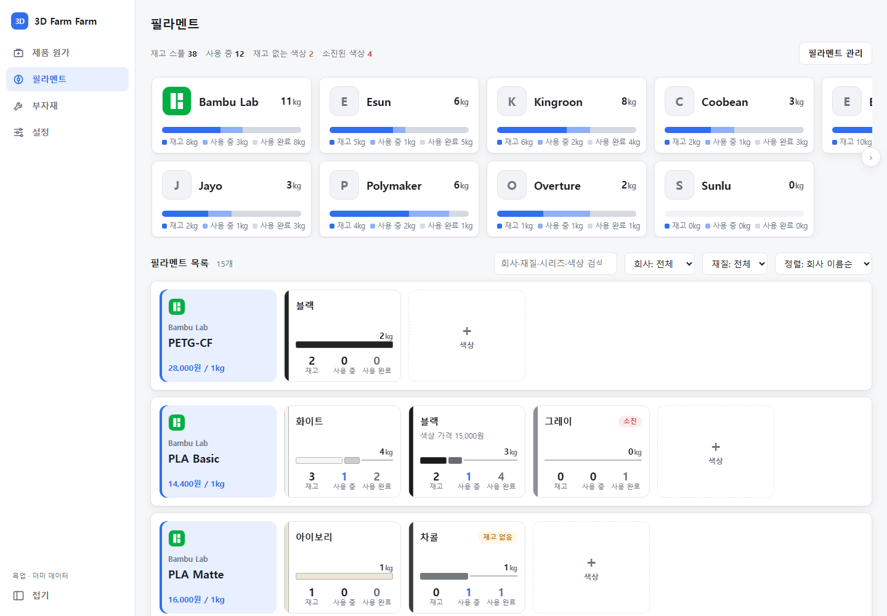

<details><summary>다크 테마</summary>

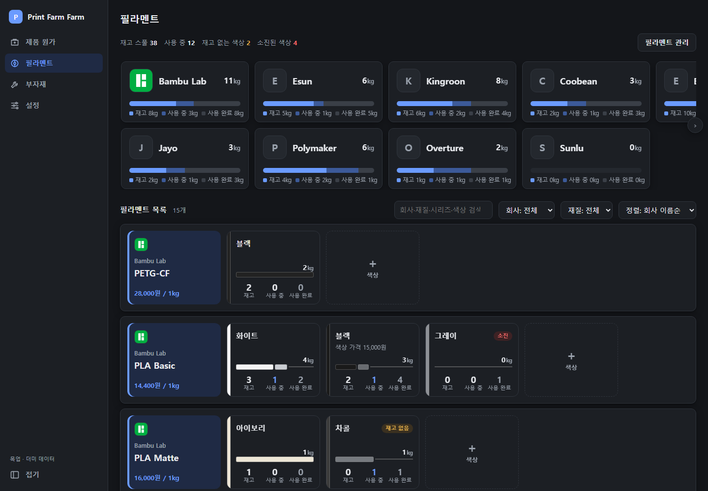
</details>

화면은 위에서부터 **전체 요약 → 회사별 요약 → 필라멘트 목록** 순서다.

### 1.1 전체 요약 (맨 위 한 줄)

| 항목 | 규칙 |
|---|---|
| `재고 스풀` · `사용 중` | 전체 스풀 수 |
| `재고 없는 색상` | 재고 0개 + 사용 중 1개 이상인 색상 수. 숫자만 주황 |
| `소진된 색상` | 재고·사용 중 모두 0개인 색상 수. 숫자만 빨강 |
| `필라멘트 관리` | 오른쪽 끝 버튼 → 필라멘트 관리 모달 |

- 작은 글씨 한 줄. 검색·필터와 상관없이 항상 전체 기준.

### 1.2 회사별 요약

| 항목 | 규칙 |
|---|---|
| 표시 대상 · 순서 | 등록된 **모든 회사**, 사용량(사용 중 + 사용 완료 kg) 많은 순 → 같으면 이름순. 검색·필터와 무관 |
| 카드 | 고정 크기 260×124. 대표 이미지(없으면 첫 글자) · 회사 이름 · 오른쪽에 보유량(재고 + 사용 중 kg) |
| 막대 | 재고(진한 파랑) · 사용 중(연한 파랑) · 사용 완료(회색) 무게 비율. 아래에 상태별 kg |
| 클릭 | 카드 어디든 누르면 필라멘트 목록을 그 회사로 필터 (선택된 카드는 파란 테두리). 다시 누르면 해제 |
| 배치 | 한 줄에 다 들어가면 1줄, 넘치면 **2줄로 나누고 가로로 슬라이드** |
| 넘기기 | 스크롤바는 숨김. 좌우 `‹` `›` 버튼(넘길 수 있을 때만 표시), 마우스로 끌기, 휠 |

### 1.3 필라멘트 목록


**제목 줄**: `필라멘트 목록 N개` + 오른쪽에 검색 · 회사 필터 · 재질 필터 · 정렬 (+ 조건이 있으면 `필터 지우기`)

| 도구 | 규칙 |
|---|---|
| 검색 | 회사 · 재질 · 시리즈 · 색상 이름. 색상 이름으로 찾으면 그 색상 타일만 표시 |
| 필터 | 회사 / 재질 (전체 또는 하나) |
| 정렬 | 회사 이름순 · 재고 많은 순(재고 + 사용 중 kg) · 재고 적은 순 · 전체 많은 순 |
| 적용 범위 | **목록에만** 적용 (전체 요약 · 회사별 요약은 그대로) |

**필라멘트 묶음** — 필라멘트마다 카드 하나. 안의 칸은 모두 같은 크기(190×150)이고 넘치면 아래로 줄바꿈한다.

| 칸 | 내용 |
|---|---|
| 제목 타일 (첫 칸) | 연한 파란 배경 + 왼쪽 강조선. 로고 · 회사 · 필라멘트 이름(재질 + 시리즈) · 스풀 가격(`14,400원 / 1kg`, 없으면 회색 `가격 미입력`). 마우스를 올리면 보유 스풀 평균 구매가 · 사용 제품 수 |
| 색상 타일 | 왼쪽 색 선(색상 코드 색, 얇은 테두리) · 색상 이름 · 상태 배지(재고 없음/소진) · 색상별 가격(있을 때만) · 보유 kg · 막대 · 재고/사용 중/사용 완료 개수 |
| `+ 색상` 타일 | 점선. 누르면 이 필라멘트로 고정된 색상 추가 모달 |

**색상 타일 막대** (그 색상으로 그림)
| 구간 | 모양 |
|---|---|
| 재고 | 그 색 두꺼운 칸 |
| 사용 중 | 그 색을 연하게 한 두꺼운 칸 |
| 사용 완료 | 가는 회색 선 |

- 검정·흰색도 보이도록 칸마다 얇은 테두리, 칸 사이 간격. 스풀이 하나도 없으면 가는 선만.
- 색상 코드(hex)는 타일에 쓰지 않는다 (색상 수정 모달과 타일 메뉴에서만 표시).

### 1.4 색상 타일 메뉴


| 항목 | 동작 |
|---|---|
| 머리 | 색 동그라미 · 색상 이름 · 색상 코드 |
| `+ 재고 추가` | 재고 추가 모달 |
| `사용 중으로` (재고 N) | 사용 시작할 스풀 선택 모달. 재고 0이면 비활성 |
| `사용 완료로` (사용 중 N) | 사용 완료할 스풀 선택 모달. 사용 중 0이면 비활성 |
| `⚙ 스풀 조정` | 스풀 조정 모달. 스풀이 없으면 비활성 |
| `색상 수정` | 색상 수정 모달 |

- 타일을 누르면 타일 아래(공간이 없으면 위)에 열림. 다시 누르기 · 바깥 클릭 · Esc · 스크롤로 닫힘.

---

### 1.5 [모달] 필라멘트 관리

| 회사·필라멘트 탭 | 재질 탭 |
|---|---|
|  |  |

| 탭 | 구성 |
|---|---|
| 회사·필라멘트 | 왼쪽 회사 목록(로고 · 이름 · 필라멘트 수 · `수정`, `+ 회사 추가`) / 오른쪽 선택한 회사의 필라멘트(이름 · 색상 수 · 가격 · `수정`, `+ 필라멘트 추가`) |
| 재질 | 재질 목록(이름 · 사용하는 필라멘트 수 · `수정`, `+ 재질 추가`) |

| 회사 추가 / 수정 | 필라멘트 추가 / 수정 |
|---|---|
|  |  |

| 대상 | 입력 | 삭제 |
|---|---|---|
| 회사 | 이름* · 대표 이미지(파일 선택 + 미리보기, `이미지 지우기`) | 필라멘트가 있으면 불가 |
| 필라멘트 | 재질*(선택, 목록 끝 `+ 새 재질…`) · 시리즈(선택) · 스풀 가격 · 스풀 무게(기본 1000g). 아래에 표시 이름 미리보기 | 색상이 있거나 제품에서 쓰면 불가 |
| 재질 | 이름*(예: PETG-CF, 중복 불가) | 필라멘트에서 쓰면 불가 |

- 필라멘트 수정은 이 모달에서만 한다 (필라멘트 목록에는 수정 버튼 없음).

### 1.6 [모달] 색상 추가 / 수정


| 항목 | 규칙 |
|---|---|
| 회사* · 필라멘트* | `+ 색상` 타일 또는 수정으로 열면 고정(비활성) |
| 색상 이름* | 같은 필라멘트 안에서 중복 불가 |
| 색상 코드* | 글자 입력칸 + 색 미리보기 + 색 선택기. `F5F5F5` / `#f5f5f5` 붙여넣기 허용 → `#F5F5F5` 로 저장. 형식이 틀리면 빨간 안내. 색 선택기로 고르면 입력칸도 채워짐 |
| 가격 | 비우면 필라멘트 가격 사용 (안내 문구에 필라멘트 가격 표시) |
| 삭제 | 스풀이 있으면 불가 |

### 1.7 [모달] 재고 추가


수량(1~100) · 구매일(기본 오늘) · 스풀 1개 구매가(기본 색상 가격, 없으면 필라멘트 가격) · 번호 지정(선택, 비우면 자동) → `재고에 추가`
- 번호 지정은 입력칸 하나에 쉼표 · 범위로 적는다: `11, 15, 20-25`. 화면에서 번호 목록으로 풀어 보낸다
- 지정한 번호를 먼저 쓰고 모자란 만큼은 자동. 이미 쓰는 번호 · 수량보다 많음 · 중복이면 빨간 안내 (예: `S00042 는 이미 있습니다`)
→ 알림에 생성된 스풀 코드 범위(`S00041 ~ S00043`) + `되돌리기`

### 1.8 [모달] 사용 시작할 / 사용 완료할 스풀 선택


- 좁은 창. 해당 상태의 스풀 목록: 코드 + 구매일(또는 사용 시작일). 줄을 누르면 바로 처리하고 닫힘 → 알림 + `되돌리기`
- 10개씩 페이지 넘김 (`« ‹ 1 2 3 4 5 › »`)

### 1.9 [모달] 스풀 조정

| 간단 | 세부 |
|---|---|
|  |  |

| 보기 | 열 | 동작 |
|---|---|---|
| 간단 | 스풀 · 구매일 · 구매가 입력 · `재고` `사용 중` `사용 완료` | 현재 상태 버튼은 회색·비활성. 거꾸로 이동(사용 완료 → 사용 중 등)은 확인 문구. 구매가는 입력 즉시 저장 |
| 세부 | 스풀 · 상태 · 구매일 · 사용 시작일 · 사용 완료일 · 구매가 입력 · ✕ | ✕ = 스풀 삭제(확인 문구) → 알림 + `되돌리기` |

- 오른쪽 위 `간단 | 세부` 전환. 창 높이 고정, 10개씩 페이지 넘김.
- 상태를 바꿔도 창은 열린 채 같은 페이지에 머문다. 알림의 `되돌리기` 를 누르면 창도 갱신.

---

## 2. 제품 원가


<details><summary>다크 테마</summary>

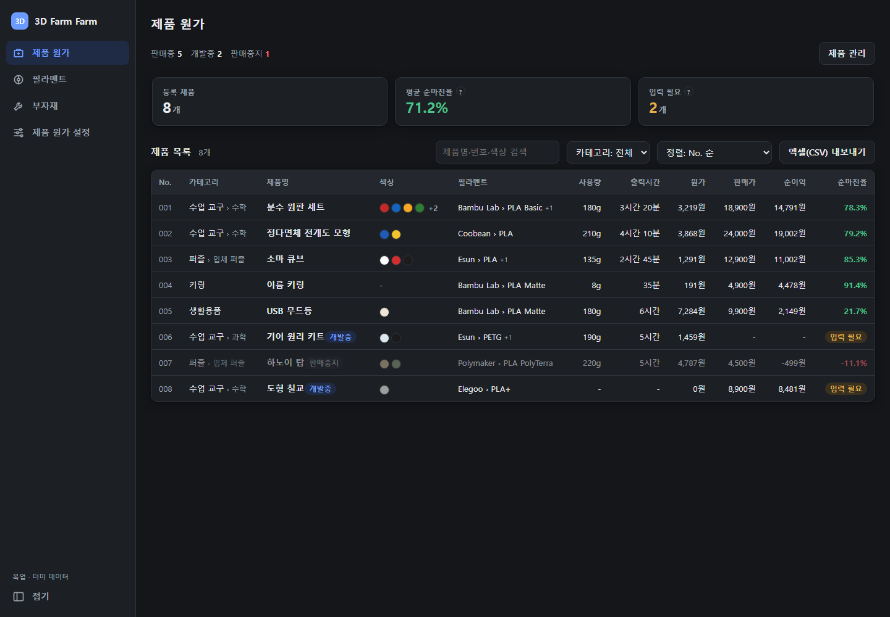
</details>

화면은 위에서부터 **상태별 개수 → 요약 카드 → 제품 목록** 순서다. 배치 · 간격은 필라멘트 화면과 같다.

### 2.1 상태별 개수 (맨 위 한 줄)

| 항목 | 규칙 |
|---|---|
| `판매중` · `개발중` · `판매중지` | 상태별 제품 수. 판매중지가 1개 이상이면 숫자만 빨강 |
| `제품 관리` | 오른쪽 끝 버튼 → 제품 관리 모달 |

- 작은 글씨 한 줄 (필라멘트 화면의 전체 요약과 같은 모양). 검색 · 필터와 상관없이 항상 전체 기준.

### 2.2 요약 카드

| 카드 | 규칙 |
|---|---|
| 등록 제품 | 전체 제품 수 |
| 평균 순마진율 | **판매중이고 입력이 끝난 제품만** 평균. 색은 순마진율 색 규칙 |
| 입력 필요 | 입력이 덜 된 제품 수(주황). 누르면 그 제품만 목록에 보기 (선택된 카드는 파란 테두리, 다시 누르면 해제) |

- 설명 문구는 카드에 쓰지 않고 카드 제목 옆 `(?)` 에 마우스를 올리면 위로 표시 (`판매중이고 입력이 끝난 제품 5개 기준 · 수수료 반영` 등).
- 카드 3개는 같은 높이, 내용은 위에서부터.

### 2.3 제품 목록

**제목 줄**: `제품 목록 N개` + 오른쪽에 검색 · 카테고리 필터 · 정렬 (+ 조건이 있으면 `필터 지우기`) · `엑셀(CSV) 내보내기`

| 도구 | 규칙 |
|---|---|
| 검색 | 제품명 · No. · 색상 이름 |
| 카테고리 필터 | `카테고리: 전체` / 카테고리 / 그 아래 세부 분류(들여쓰기) |
| 정렬 | `정렬: No. 순`(기본) · 이름순 · 순마진율 낮은 순 · 순마진율 높은 순 · 원가 높은 순. 입력이 덜 된 제품은 순마진율 정렬에서 맨 뒤 |
| 엑셀(CSV) 내보내기 | 제품별 원가 내역 CSV (UTF-8 BOM). 검색 · 필터와 상관없이 전체 |

**제품 표** — 행을 누르면 제품 수정 모달.

| 열 | 내용 |
|---|---|
| No. · 카테고리 | `수업 교구 › 수학` (세부 분류는 회색). 없으면 회색 `미분류` |
| 제품명 | 굵게 + 상태 배지 (판매중은 배지 없음, 개발중 파랑 · 판매중지 회색). 판매중지 행은 흐리게 |
| 색상 | 사용 필라멘트 줄에서 고른 색상의 색 동그라미 (같은 색상은 한 번, 얇은 테두리). 5개가 넘으면 4개 + `+N`. 마우스를 올리면 색상 이름 전체 |
| 필라멘트 | 첫 필라멘트 이름 + `+N`. 마우스를 올리면 전체 (필라멘트 · 색상 · 사용량) |
| 사용량 · 출력시간 · 원가 · 판매가 · 순이익 | 제품 1개 기준 |
| 순마진율 | 0% 미만 빨강 / 20% 미만 주황 / 그 외 초록. 입력이 덜 된 제품은 숫자 대신 주황 `입력 필요` 배지 (마우스를 올리면 빠진 항목) |

### 2.4 [모달] 제품 관리

| 제품 관리 | 카테고리 수정 |
|---|---|
|  | 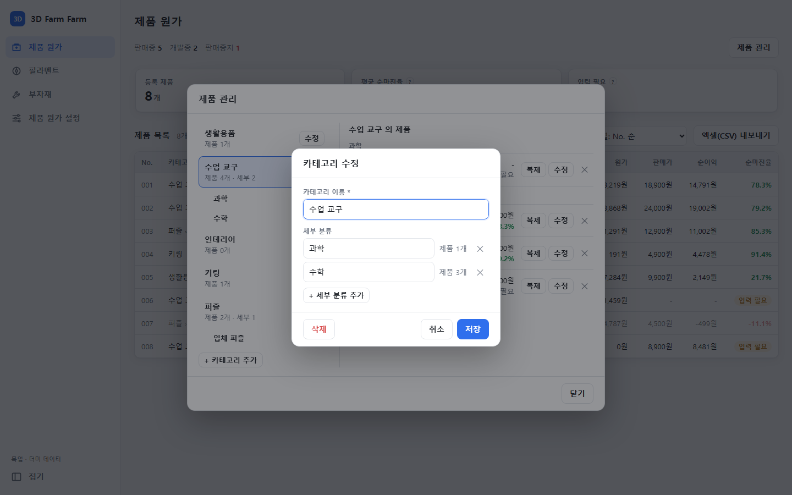 |

필라멘트 관리와 같은 2단 구조. 카테고리 관리와 제품 추가 · 복제 · 삭제를 여기서 한다.

| 영역 | 구성 |
|---|---|
| 왼쪽 | 카테고리 목록 (이름순): 이름 · `제품 N개 · 세부 N` · `수정`. 그 아래 세부 분류를 들여쓰기 (이름 · 제품 수). 카테고리가 없는 제품이 있으면 회색 `미분류`. 맨 아래 `+ 카테고리 추가` |
| 오른쪽 | 고른 카테고리(또는 세부 분류)의 제품. 카테고리를 고르면 세부 분류별로 묶어서 표시. 줄: 제품명 · 상태 배지 · No. · 판매가 · 순마진율(또는 `입력 필요`) · `복제` `수정` `✕`. 맨 아래 `+ 제품 추가` |

| 동작 | 규칙 |
|---|---|
| `+ 제품 추가` | 제품 추가 모달 (지금 고른 카테고리 · 세부 분류가 미리 선택됨) |
| `복제` | 재료(필라멘트 · 색상 · 부자재)까지 복사한 제품 추가 모달. No. 는 다음 번호, 이름은 `원래 이름 (복사)`, 상태는 개발중. 저장해야 추가됨 |
| `✕` | 확인 문구 후 제품 삭제 |
| 카테고리 추가 / 수정 | 좁은 창: 카테고리 이름* + 세부 분류 목록(이름 · 제품 수 · ✕, `+ 세부 분류 추가`). 세부 분류는 필요할 때만 |
| 삭제 제한 | 제품이 있는 카테고리 · 세부 분류는 삭제 불가 (세부 분류 ✕ 도 막음). 이름은 카테고리 전체에서, 세부 분류는 카테고리 안에서 중복 불가 |

- 추가 · 수정 · 복제 창은 제품 관리 창 위에 겹쳐 열리고, 저장하면 관리 창과 목록이 함께 갱신된다.

### 2.5 [모달] 제품 추가 / 수정

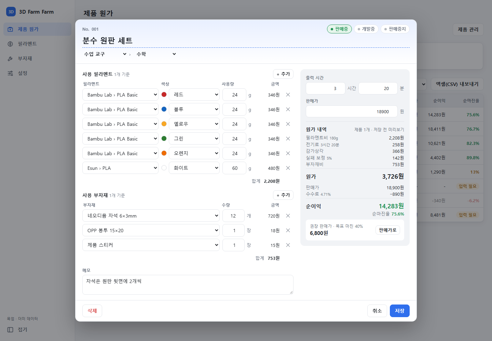

넓은 창. 창 제목은 따로 없고 맨 위 머리 띠의 제품명이 제목.

| 영역 | 내용 |
|---|---|
| 머리 띠 (옅은 파랑) | 윗줄: `No. 1` · (추가면 파란 `새 제품` 배지, 복제면 회색 `○○에서 복제`) · 오른쪽에 상태 알약 버튼 `판매중` `개발중` `판매중지` (점 + 이름, 판매중 초록 · 개발중 파랑 · 판매중지 회색). 가운데: 제품명* 크게. 아래: `카테고리 › 세부 분류` 선택 (`미분류` · 카테고리들 · `+ 새 카테고리…`, 세부 분류가 없으면 비활성) |
| 왼쪽: 사용 필라멘트 (1개 기준) | 표: 필라멘트 · 색상(색 동그라미 + 선택, `색상 선택 안 함` 가능) · 사용량(g) · 금액 · ✕. 아래 합계. `+ 추가` |
| 왼쪽: 사용 부자재 (1개 기준) | 표: 부자재 · 수량(부자재 단위) · 금액 · ✕. 아래 합계. `+ 추가` |
| 왼쪽: 메모 | 여러 줄 |
| 오른쪽 위: 원가 입력 | 출력 시간(시 + 분) · 판매가 |
| 오른쪽: 원가 내역 (실시간) | 필라멘트비(총 g) · 전기료 · 부자재비 → **원가** / 판매가 · 수수료 · 배송비* → **순이익**, 순마진율 / 목표 마진율 기준 권장 판매가 + `판매가로` / 입력 경고 목록 |

\* 0원이면 숨김. 아래 버튼: `삭제`(수정 시) · `취소` · `저장`

| 규칙 | 내용 |
|---|---|
| 재료 줄 | 한 항목 = 한 줄. 끝에 그 줄 금액. g당 단가 · 개당 단가는 금액에 마우스를 올리면 (`색상 가격 15,000원 / 1000g · g당 15.0원`). 가격이 없으면 주황 `가격 없음` + 선택칸 주황 테두리 |
| 색상 · 가격 | 필라멘트 줄의 금액은 고른 색상의 가격 기준 (색상 가격이 없거나 색상을 안 고르면 필라멘트 가격). 필라멘트를 바꾸면 색상은 `색상 선택 안 함` 으로 |
| 입력 칸 모양 | No. · 카테고리 · 세부 분류는 평소엔 글자처럼, 마우스를 올리면 테두리 |
| 입력 경고 (= "입력 필요") | 필라멘트 사용량 · 출력 시간 · 판매가 미입력, 필라멘트 · 부자재 가격 미입력 |
| No. | 추가 · 복제 시 다음 번호 자동. 중복이면 저장 거부 |

## 3. 부자재


<details><summary>다크 테마</summary>

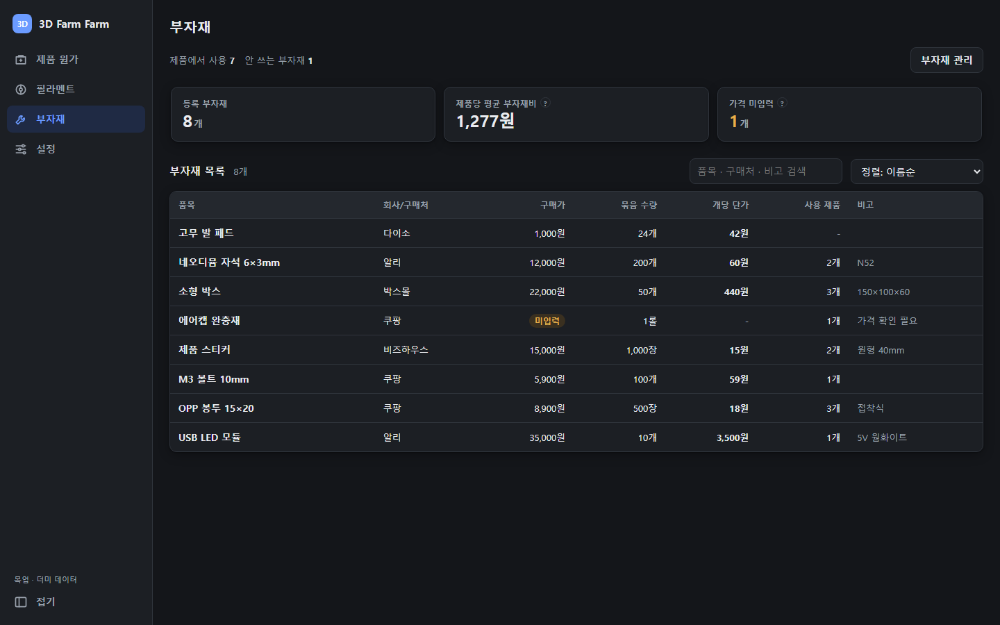
</details>

화면은 제품 원가와 같은 **사용 여부 개수 → 요약 카드 → 부자재 목록** 순서다.

### 3.1 사용 여부 개수 (맨 위 한 줄)

| 항목 | 규칙 |
|---|---|
| `제품에서 사용` · `안 쓰는 부자재` | 제품에서 쓰는 / 안 쓰는 부자재 수 |
| `부자재 관리` | 오른쪽 끝 버튼 → 부자재 관리 모달 |

- 작은 글씨 한 줄. 검색 · 필터와 상관없이 항상 전체 기준.

### 3.2 요약 카드

| 카드 | 규칙 |
|---|---|
| 등록 부자재 | 전체 부자재 수 |
| 제품당 평균 부자재비 | **판매중이고 부자재를 쓰는 제품만** 제품 1개의 부자재비 평균. 가격 미입력 부자재는 0원 |
| 가격 미입력 | 가격이 없는 부자재 수(주황). 누르면 그 부자재만 목록에 보기 (선택된 카드는 파란 테두리, 다시 누르면 해제) |

- 설명 문구는 제품 원가처럼 카드 제목 옆 `(?)` 에 마우스를 올리면 표시.

### 3.3 부자재 목록

**제목 줄**: `부자재 목록 N개` + 오른쪽에 검색 · 정렬 (+ 조건이 있으면 `필터 지우기`)

| 도구 | 규칙 |
|---|---|
| 검색 | 품목 · 구매처 · 비고 |
| 정렬 | `정렬: 이름순`(기본) · 개당 단가 높은 순 · 사용 제품 많은 순 · 구매처순. 가격 미입력은 단가 정렬에서 맨 뒤, 구매처가 없으면 구매처순에서 맨 뒤 |

**부자재 표** — 행을 누르면 부자재 수정 모달.

| 열 | 내용 |
|---|---|
| 품목 | 굵게 |
| 회사/구매처 | 없으면 `-` |
| 구매가 | 묶음 전체 가격. 없으면 주황 `미입력` 배지 |
| 묶음 수량 | 단위 포함 (`200개`, `500장`) |
| 개당 단가 | 구매가 ÷ 묶음 수량, 굵게. 10원 미만은 소수 1자리 |
| 사용 제품 | 쓰는 제품 수. 마우스를 올리면 제품 이름 · 수량. 안 쓰면 `-` |
| 비고 | 회색, 길면 줄임 (마우스를 올리면 전체) |

### 3.4 [모달] 부자재 관리

| 부자재 관리 | 부자재 수정 |
|---|---|
| 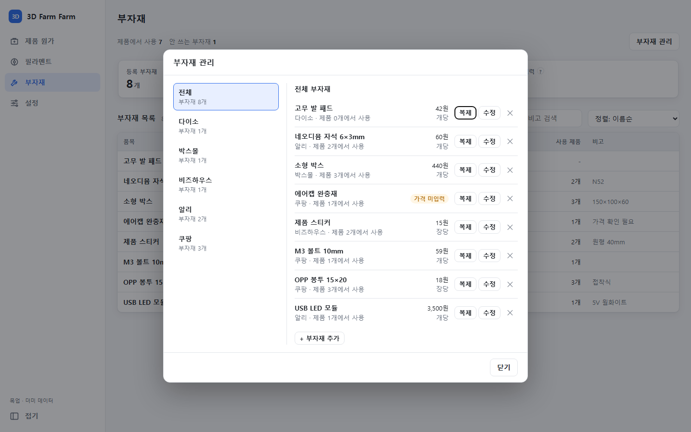 | 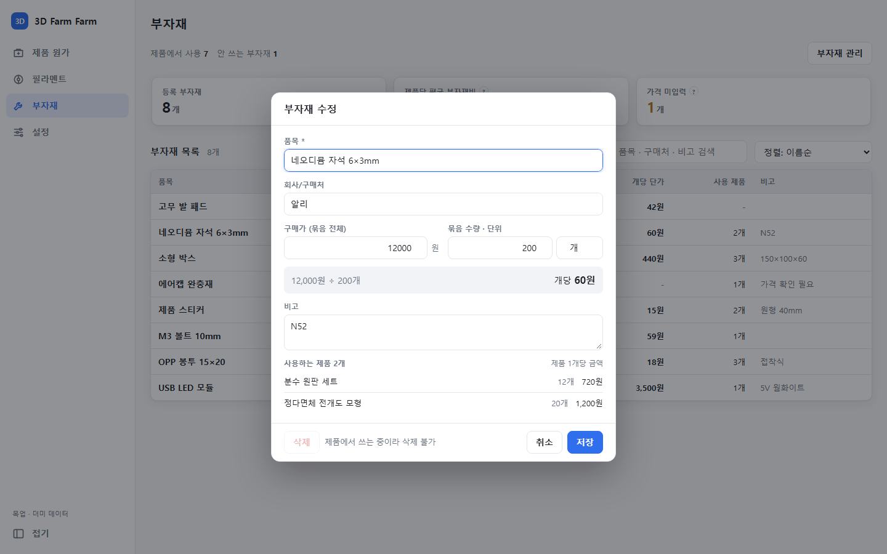 |

제품 관리와 같은 2단 구조. 부자재 추가 · 복제 · 삭제를 여기서 한다.

| 영역 | 구성 |
|---|---|
| 왼쪽 | `전체` + 구매처 목록 (이름순): 구매처 · `부자재 N개`. 구매처가 없는 부자재가 있으면 회색 `구매처 없음` |
| 오른쪽 | 고른 구매처의 부자재 (이름순). 줄: 품목 · `제품 N개에서 사용` (`전체` 에서는 구매처도) · 개당 단가(또는 주황 `가격 미입력`) · `복제` `수정` `✕`. 맨 아래 `+ 부자재 추가` |

| 동작 | 규칙 |
|---|---|
| `+ 부자재 추가` | 부자재 추가 모달 (지금 고른 구매처가 미리 채워짐) |
| `복제` | 값을 복사한 부자재 추가 모달. 이름은 `원래 이름 (복사)`, 창 제목 옆에 회색 `○○에서 복제`. 사용하는 제품은 복사하지 않음. 저장해야 추가됨 |
| `✕` | 제품에서 쓰면 삭제 불가 알림, 아니면 확인 문구 후 삭제 |

- 추가 · 수정 · 복제 창은 관리 창 위에 겹쳐 열리고, 저장하면 관리 창과 목록이 함께 갱신된다.

### 3.5 [모달] 부자재 추가 / 수정

| 항목 | 내용 |
|---|---|
| 창 제목 | `부자재 수정` / `부자재 추가` (+ 파란 `새 부자재` 배지, 복제면 회색 `○○에서 복제`) |
| 입력 | 품목* · 회사/구매처 · 구매가(묶음 전체, 비우면 미입력) · 묶음 수량 · 단위(기본 `개`, 개 · 장 · 롤 · 세트 · m · g 자동완성) · 비고 |
| 단가 미리보기 | `12,000원 ÷ 200개` → `개당 60원`. 수정 중 단가가 바뀌면 이전 단가를 줄 그어 함께. 가격이 없으면 주황 `가격 미입력 · 원가에 0원` |
| 사용하는 제품 (수정 시) | 제품 · 상태 배지 · 수량 · 제품 1개당 이 부자재 금액. 가격을 바꾸면 `720원 → 900원` (오르면 빨강, 내리면 초록) |
| 버튼 | `삭제`(수정 시) · `취소` · `저장`. 제품에서 쓰면 `삭제` 비활성 + `제품에서 쓰는 중이라 삭제 불가` |

- 품목 이름은 중복 불가.
- 저장하면 이 부자재를 쓰는 제품 원가에 바로 반영 (가격이 바뀌었으면 알림에 `제품 N개 원가에 바로 반영돼요`).

## 4. 제품 원가 설정

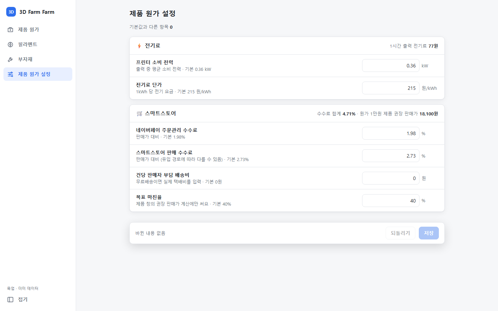

<details><summary>다크 테마</summary>

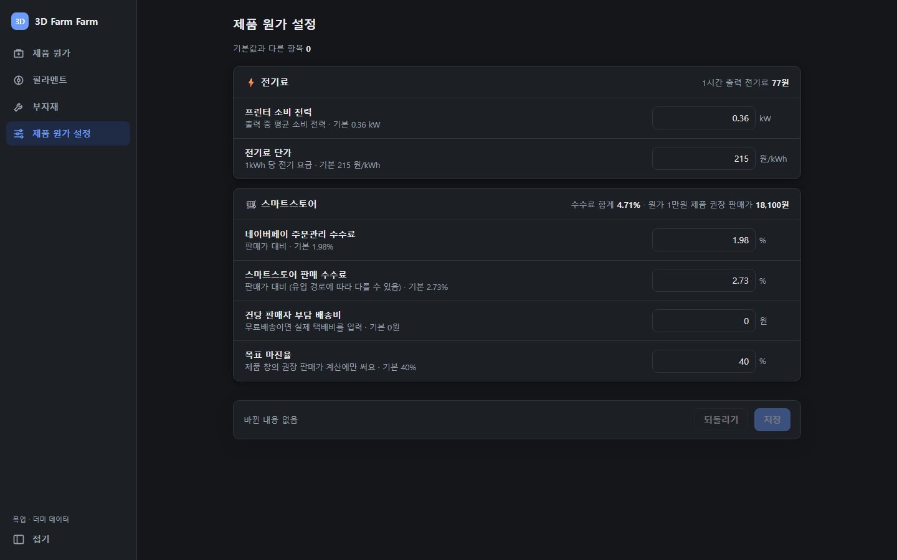
</details>

| 값을 바꾼 상태 | 틀린 값이 있는 상태 |
|---|---|
|  | 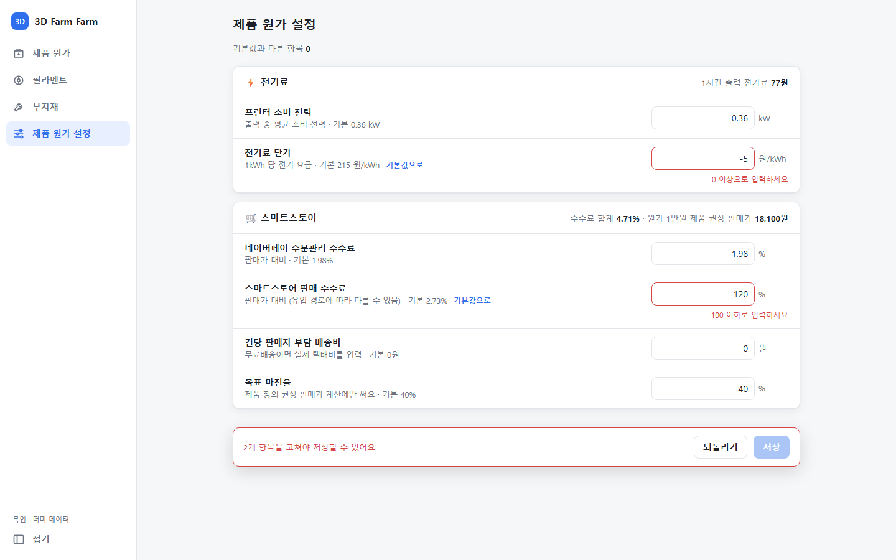 |

제품 원가 계산에 쓰는 값만 모은 화면. 다른 화면보다 좁게(최대 960px) 위에서부터 **요약 한 줄 → 설정 묶음 → 저장 줄** 순서다.

| 묶음 | 항목 (기본값) | 제목 줄 오른쪽 계산 예시 |
|---|---|---|
| ⚡ 전기료 | 프린터 소비 전력 (0.36 kW) · 전기료 단가 (215 원/kWh) | 1시간 출력 전기료 |
| 🛒 스마트스토어 | 네이버페이 주문관리 수수료 (1.98%) · 스마트스토어 판매 수수료 (2.73%) · 건당 판매자 부담 배송비 (0원) · 목표 마진율 (40%) | 수수료 합계 · 원가 1만원 제품 권장 판매가 (수수료 + 목표 마진율이 100% 이상이면 주황 `계산 불가`) |

| 요소 | 규칙 |
|---|---|
| 요약 한 줄 | `기본값과 다른 항목 N` (1개 이상이면 숫자 파랑). 다른 화면의 요약 줄과 같은 모양 |
| 항목 줄 | 왼쪽: 이름(굵게) + 설명 한 줄 · `기본 N` (기본값과 다르면 `기본값으로` 버튼). 오른쪽: 입력칸(오른쪽 정렬) + 단위 |
| 입력칸 | 바꾼 칸은 파란 배경. 틀린 칸은 빨간 테두리 + 칸 아래 빨간 문구 (`100 이하로 입력하세요` 등, 앱 공통 문구). 천 단위 쉼표 허용 |
| 입력 범위 | 서버와 같게: 소비 전력 0 이상 · 소수 3자리, 전기료 단가 0 이상 · 소수 1자리, % 칸 0 ~ 100 · 소수 2자리, 배송비 0 이상 정수 |
| 저장 줄 | 화면 아래에 붙어 있음. `바뀐 내용 없음` / `N개 항목을 바꿨어요 · 저장하면 모든 제품 원가에 바로 반영돼요`(파란 테두리) / `N개 항목을 고쳐야 저장할 수 있어요`(빨간 테두리) + `되돌리기` · `저장`. 바뀐 게 없거나 틀린 칸이 있으면 `저장` 비활성 |
| 저장 · 되돌리기 | 저장하면 알림 `저장했어요 · 모든 제품 원가에 반영됐어요`. `되돌리기` 는 저장된 값으로 |
| 나가기 | 저장하지 않은 값이 있으면 브라우저 확인 |

- 프린터(구매가 · 예상 수명 · 출력 실패율)와 백업은 이 화면에서 뺐다 (프린터는 추후 투자 장비 · 이윤 계산에서, PRD 5장)
