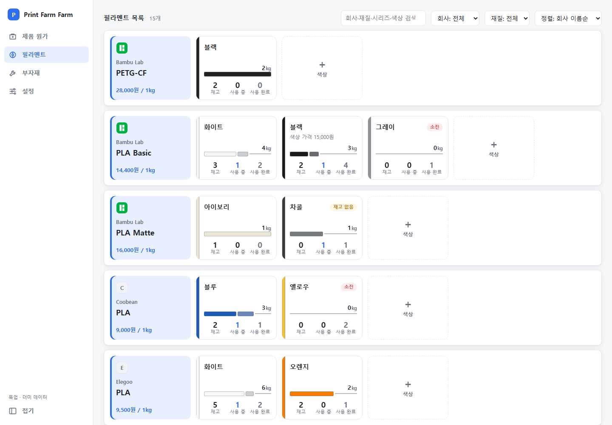
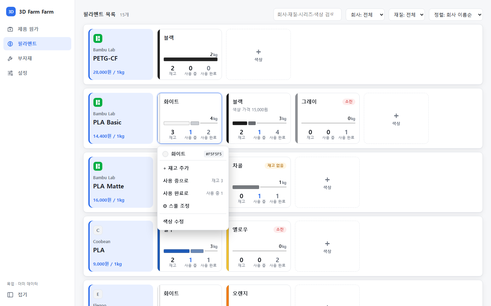
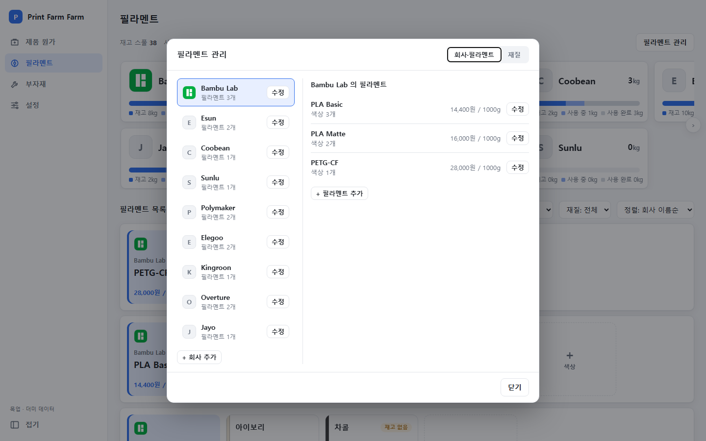
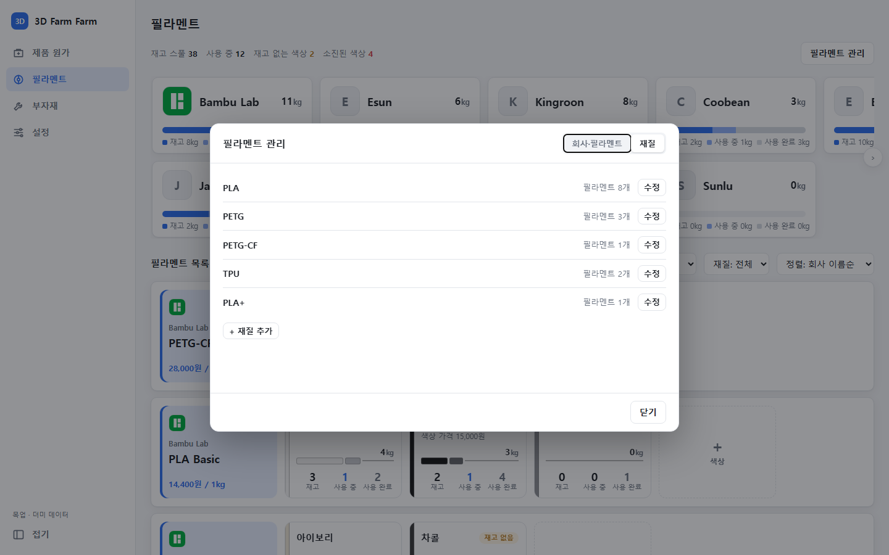
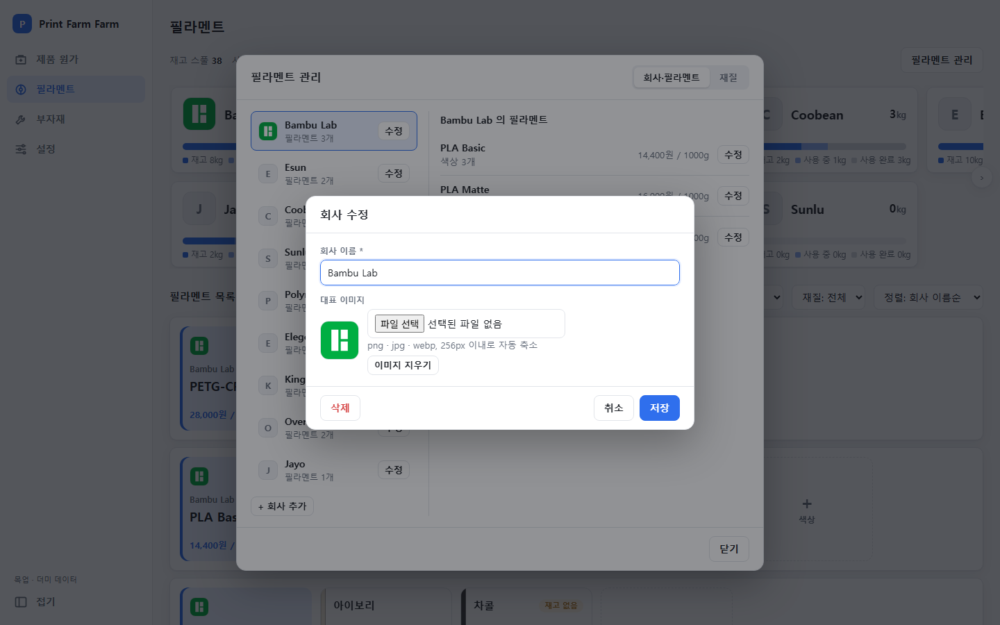
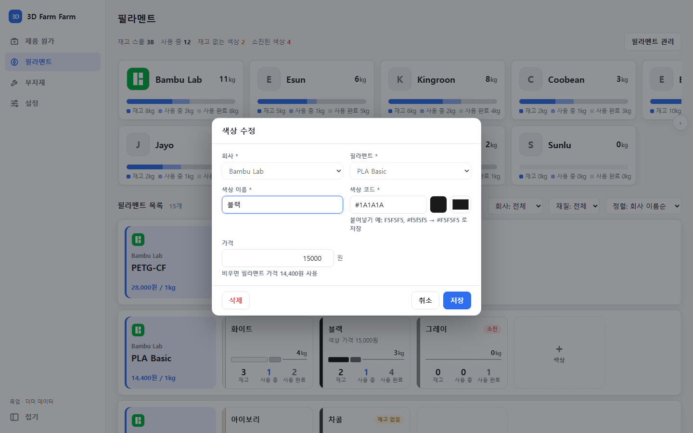
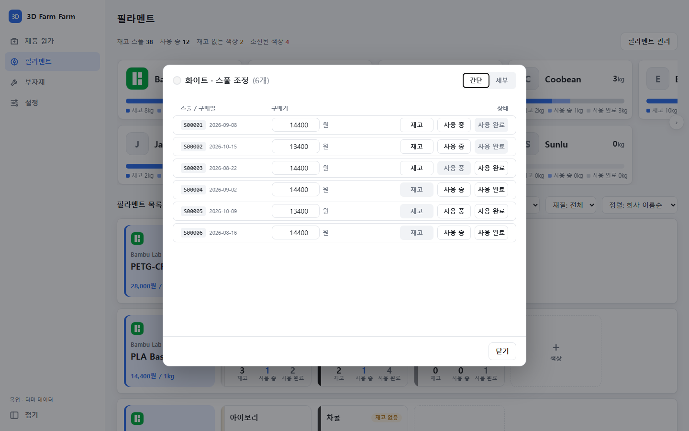

# 화면 구성 — 3D Farm Farm (쓰리디팜팜)

> 요구사항: [PRD.md](PRD.md) · 데이터 구조: [ERD.md](ERD.md)
> 화면 목업: [mockups/](mockups/) — HTML 파일을 브라우저로 열면 더미 데이터로 동작한다.
> 스크린샷: [screens/](screens/) (1440px, 라이트 테마)

| 화면 | 상태 |
|---|---|
| 필라멘트 | ✅ 목업 확정 — [mockups/filaments.html](mockups/filaments.html) |
| 제품 원가 · 부자재 · 설정 | 📝 글 명세만 (목업 예정) |

## 메뉴 구조

```
3D Farm Farm (왼쪽 사이드바)
├─ 제품 원가
│   └─ [모달] 제품 추가 / 수정
├─ 필라멘트
│   ├─ [메뉴] 색상 타일 메뉴
│   ├─ [모달] 필라멘트 관리 (회사·필라멘트 / 재질)
│   │   ├─ [모달] 회사 추가 / 수정
│   │   ├─ [모달] 필라멘트 추가 / 수정
│   │   └─ [모달] 재질 추가 / 수정
│   ├─ [모달] 색상 추가 / 수정
│   ├─ [모달] 재고 추가
│   ├─ [모달] 사용 시작할 / 사용 완료할 스풀 선택
│   └─ [모달] 스풀 조정 (간단 / 세부)
├─ 부자재
│   └─ [모달] 부자재 추가 / 수정
└─ 설정
```

## 공통

| 요소 | 동작 |
|---|---|
| 사이드바 | 펼치면 아이콘 + 메뉴 이름(220px), `접기` 를 누르면 아이콘만(64px, 마우스를 올리면 이름). 접힘 상태는 브라우저에 기억. 폭 760px 이하에서는 항상 아이콘만 |
| 화면 제목 | 각 화면 맨 위에 화면 이름 |
| 추가·수정 | 대화상자(모달). `닫기`/`취소` 또는 Esc 로 닫힘 |
| 알림(토스트) | 화면 하단. 기본 2.2초, `되돌리기` 버튼이 있으면 7초 |
| 상태 색 | 재고 없음 = 주황 · 소진 = 빨강 · 사용 중 숫자 = 파랑 |
| 테마 | 시스템 설정에 따라 라이트/다크 |

---

## 1. 필라멘트


<details><summary>다크 테마</summary>


</details>

화면은 위에서부터 **전체 요약 → 회사별 요약 → 필라멘트 목록** 순서다.

### 1.1 전체 요약 (맨 위 한 줄)

| 항목 | 규칙 |
|---|---|
| `재고 스풀` · `사용 중` | 전체 스풀 수 |
| `재고 없는 색상` | 재고 0개 + 사용 중 1개 이상인 색상 수. 숫자만 주황 |
| `소진된 색상` | 재고·사용 중 모두 0개인 색상 수. 숫자만 빨강 |
| `필라멘트 관리` | 오른쪽 끝 버튼 → 필라멘트 관리 모달 |

- 작은 글씨 한 줄. 검색·필터와 상관없이 항상 전체 기준.

### 1.2 회사별 요약

| 항목 | 규칙 |
|---|---|
| 표시 대상 · 순서 | 등록된 **모든 회사**, 사용량(사용 중 + 사용 완료 kg) 많은 순 → 같으면 이름순. 검색·필터와 무관 |
| 카드 | 고정 크기 260×124. 대표 이미지(없으면 첫 글자) · 회사 이름 · 오른쪽에 보유량(재고 + 사용 중 kg) |
| 막대 | 재고(진한 파랑) · 사용 중(연한 파랑) · 사용 완료(회색) 무게 비율. 아래에 상태별 kg |
| 클릭 | 카드 어디든 누르면 필라멘트 목록을 그 회사로 필터 (선택된 카드는 파란 테두리). 다시 누르면 해제 |
| 배치 | 한 줄에 다 들어가면 1줄, 넘치면 **2줄로 나누고 가로로 슬라이드** |
| 넘기기 | 스크롤바는 숨김. 좌우 `‹` `›` 버튼(넘길 수 있을 때만 표시), 마우스로 끌기, 휠 |

### 1.3 필라멘트 목록



**제목 줄**: `필라멘트 목록 N개` + 오른쪽에 검색 · 회사 필터 · 재질 필터 · 정렬 (+ 조건이 있으면 `필터 지우기`)

| 도구 | 규칙 |
|---|---|
| 검색 | 회사 · 재질 · 시리즈 · 색상 이름. 색상 이름으로 찾으면 그 색상 타일만 표시 |
| 필터 | 회사 / 재질 (전체 또는 하나) |
| 정렬 | 회사 이름순 · 재고 많은 순(재고 + 사용 중 kg) · 재고 적은 순 · 전체 많은 순 |
| 적용 범위 | **목록에만** 적용 (전체 요약 · 회사별 요약은 그대로) |

**필라멘트 묶음** — 필라멘트마다 카드 하나. 안의 칸은 모두 같은 크기(190×150)이고 넘치면 아래로 줄바꿈한다.

| 칸 | 내용 |
|---|---|
| 제목 타일 (첫 칸) | 연한 파란 배경 + 왼쪽 강조선. 로고 · 회사 · 필라멘트 이름(재질 + 시리즈) · 스풀 가격(`14,400원 / 1kg`, 없으면 회색 `가격 미입력`). 마우스를 올리면 보유 스풀 평균 구매가 · 사용 제품 수 |
| 색상 타일 | 왼쪽 색 선(색상 코드 색, 얇은 테두리) · 색상 이름 · 상태 배지(재고 없음/소진) · 색상별 가격(있을 때만) · 보유 kg · 막대 · 재고/사용 중/사용 완료 개수 |
| `+ 색상` 타일 | 점선. 누르면 이 필라멘트로 고정된 색상 추가 모달 |

**색상 타일 막대** (그 색상으로 그림)
| 구간 | 모양 |
|---|---|
| 재고 | 그 색 두꺼운 칸 |
| 사용 중 | 그 색을 연하게 한 두꺼운 칸 |
| 사용 완료 | 가는 회색 선 |

- 검정·흰색도 보이도록 칸마다 얇은 테두리, 칸 사이 간격. 스풀이 하나도 없으면 가는 선만.
- 색상 코드(hex)는 타일에 쓰지 않는다 (색상 수정 모달과 타일 메뉴에서만 표시).

### 1.4 색상 타일 메뉴



| 항목 | 동작 |
|---|---|
| 머리 | 색 동그라미 · 색상 이름 · 색상 코드 |
| `+ 재고 추가` | 재고 추가 모달 |
| `사용 중으로` (재고 N) | 사용 시작할 스풀 선택 모달. 재고 0이면 비활성 |
| `사용 완료로` (사용 중 N) | 사용 완료할 스풀 선택 모달. 사용 중 0이면 비활성 |
| `⚙ 스풀 조정` | 스풀 조정 모달. 스풀이 없으면 비활성 |
| `색상 수정` | 색상 수정 모달 |

- 타일을 누르면 타일 아래(공간이 없으면 위)에 열림. 다시 누르기 · 바깥 클릭 · Esc · 스크롤로 닫힘.

---

### 1.5 [모달] 필라멘트 관리

| 회사·필라멘트 탭 | 재질 탭 |
|---|---|
|  |  |

| 탭 | 구성 |
|---|---|
| 회사·필라멘트 | 왼쪽 회사 목록(로고 · 이름 · 필라멘트 수 · `수정`, `+ 회사 추가`) / 오른쪽 선택한 회사의 필라멘트(이름 · 색상 수 · 가격 · `수정`, `+ 필라멘트 추가`) |
| 재질 | 재질 목록(이름 · 사용하는 필라멘트 수 · `수정`, `+ 재질 추가`) |

| 회사 추가 / 수정 | 필라멘트 추가 / 수정 |
|---|---|
|  |  |

| 대상 | 입력 | 삭제 |
|---|---|---|
| 회사 | 이름* · 대표 이미지(파일 선택 + 미리보기, `이미지 지우기`) | 필라멘트가 있으면 불가 |
| 필라멘트 | 재질*(선택, 목록 끝 `+ 새 재질…`) · 시리즈(선택) · 스풀 가격 · 스풀 무게(기본 1000g). 아래에 표시 이름 미리보기 | 색상이 있거나 제품에서 쓰면 불가 |
| 재질 | 이름*(예: PETG-CF, 중복 불가) | 필라멘트에서 쓰면 불가 |

- 필라멘트 수정은 이 모달에서만 한다 (필라멘트 목록에는 수정 버튼 없음).

### 1.6 [모달] 색상 추가 / 수정



| 항목 | 규칙 |
|---|---|
| 회사* · 필라멘트* | `+ 색상` 타일 또는 수정으로 열면 고정(비활성) |
| 색상 이름* | 같은 필라멘트 안에서 중복 불가 |
| 색상 코드* | 글자 입력칸 + 색 미리보기 + 색 선택기. `F5F5F5` / `#f5f5f5` 붙여넣기 허용 → `#F5F5F5` 로 저장. 형식이 틀리면 빨간 안내. 색 선택기로 고르면 입력칸도 채워짐 |
| 가격 | 비우면 필라멘트 가격 사용 (안내 문구에 필라멘트 가격 표시) |
| 삭제 | 스풀이 있으면 불가 |

### 1.7 [모달] 재고 추가


수량(1~100) · 구매일(기본 오늘) · 스풀 1개 구매가(기본 색상 가격, 없으면 필라멘트 가격) · 번호 지정(선택, 비우면 자동) → `재고에 추가`
- 번호 지정은 입력칸 하나에 쉼표 · 범위로 적는다: `11, 15, 20-25`. 화면에서 번호 목록으로 풀어 보낸다
- 지정한 번호를 먼저 쓰고 모자란 만큼은 자동. 이미 쓰는 번호 · 수량보다 많음 · 중복이면 빨간 안내 (예: `S00042 는 이미 있습니다`)
→ 알림에 생성된 스풀 코드 범위(`S00041 ~ S00043`) + `되돌리기`

### 1.8 [모달] 사용 시작할 / 사용 완료할 스풀 선택


- 좁은 창. 해당 상태의 스풀 목록: 코드 + 구매일(또는 사용 시작일). 줄을 누르면 바로 처리하고 닫힘 → 알림 + `되돌리기`
- 10개씩 페이지 넘김 (`« ‹ 1 2 3 4 5 › »`)

### 1.9 [모달] 스풀 조정

| 간단 | 세부 |
|---|---|
|  |  |

| 보기 | 열 | 동작 |
|---|---|---|
| 간단 | 스풀 · 구매일 · 구매가 입력 · `재고` `사용 중` `사용 완료` | 현재 상태 버튼은 회색·비활성. 거꾸로 이동(사용 완료 → 사용 중 등)은 확인 문구. 구매가는 입력 즉시 저장 |
| 세부 | 스풀 · 상태 · 구매일 · 사용 시작일 · 사용 완료일 · 구매가 입력 · ✕ | ✕ = 스풀 삭제(확인 문구) → 알림 + `되돌리기` |

- 오른쪽 위 `간단 | 세부` 전환. 창 높이 고정, 10개씩 페이지 넘김.
- 상태를 바꿔도 창은 열린 채 같은 페이지에 머문다. 알림의 `되돌리기` 를 누르면 창도 갱신.

---

## 2. 제품 원가 (📝 목업 예정)

| 영역 | 내용 |
|---|---|
| 요약 | 등록 제품 수 · 평균 순마진율(수수료 반영) · 입력이 덜 된 제품 수 |
| 도구 모음 | 검색(제품명·번호·색상), 카테고리 필터, `엑셀(CSV) 내보내기`, `+ 제품 추가` |
| 제품 표 | No. · 카테고리 · 제품명(상태 배지) · 색상 · 필라멘트 · 사용량 · 출력시간 · 원가 · 판매가 · 순이익 · 순마진율 · "입력 필요" 배지 |
| 행 클릭 | 제품 수정 모달 |

순마진율 색: 0% 미만 빨강 / 20% 미만 주황 / 그 외 초록

### [모달] 제품 추가 / 수정 (넓은 창)
| 왼쪽: 입력 | 오른쪽: 원가 내역 (실시간) |
|---|---|
| No.(추가 시 다음 번호 자동) · 카테고리(기존 값 자동완성) · 제품명* · 색상 · 상태 · 출력 시간(시+분) · 판매가 | 필라멘트비(총 g) · 전기료 · 감가상각* · 실패 보정* · 부자재비 → **원가** |
| 필라멘트 행: 필라멘트 선택(`회사 › 재질 시리즈`) + 사용량(g), `+ 추가`, ✕ | 판매가 · 수수료 · 배송비* → **순이익**, 순마진율 |
| 부자재 행: 부자재 선택 + 수량, `+ 추가`, ✕ | 목표 마진율 기준 권장 판매가 |
| 메모 | 입력 경고 목록 |

\* 0원이면 숨김. 버튼: `삭제`(수정 시) · `취소` · `저장`

## 3. 부자재 (📝 목업 예정)

| 영역 | 내용 |
|---|---|
| 도구 모음 | `+ 부자재 추가` |
| 부자재 표 | 품목 · 회사/구매처 · 구매가 · 묶음 수량 · 개당 단가 · 사용 제품 수 · 비고 |
| 행 클릭 | 부자재 수정 모달 (품목* · 회사/구매처 · 구매가(묶음 전체) · 묶음 수량 · 비고) |

## 4. 설정 (📝 목업 예정)

| 묶음 | 항목 |
|---|---|
| ⚡ 전기료 | 프린터 소비 전력(kW) · 전기료 단가(원/kWh) |
| 🖨️ 프린터 | 프린터 구매가 · 예상 수명(시간) · 출력 실패율(%) |
| 🛒 스마트스토어 | 주문관리 수수료(%) · 판매 수수료(%) · 건당 판매자 부담 배송비 · 목표 마진율(%) |

버튼: `지금 백업` · `저장`. 저장하면 모든 제품 원가에 바로 반영.
